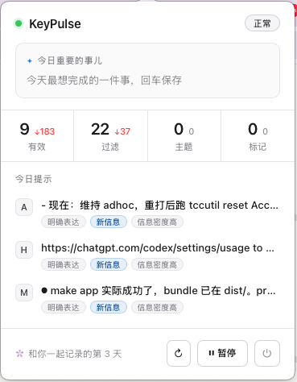

# KeyPulse

> **KeyPulse 是给 AI Agent 用的本地记忆层：在本机采集你的活动，经 MCP（Model Context Protocol）提供给 Claude / Codex / Cursor，带出处与访问控制。**

KeyPulse 静静地记录你的工作活动 —— 你切换的应用、窗口、剪贴板边界、手动笔记 —— 并在敏感信息落盘之前就把它丢掉。

Not a productivity dashboard.
Not a screen-time tracker.
Not a cloud surveillance assistant.

A private thinking mirror for knowledge workers.

[English](README.en.md) · [快速开始](#快速开始) · [隐私一览](#隐私一览) · [当前状态](#当前状态)

---

## Why star this repo?

Star KeyPulse if you care about:

- local-first personal AI
- privacy-preserving activity intelligence
- AI tools that help you think instead of replacing thought

---

## 中文介绍

KeyPulse 是一个本地优先的 macOS 工具。它在你的机器上采集工作活动 —— 你切到哪个 App、粘了一段什么、反复回到哪扇窗 —— 在敏感信息落盘之前就把它忘掉。采集到的记忆目前可以通过命令行（CLI）与菜单栏 HUD 查看；已经 MCP（一种让 AI 工具读取外部数据的标准协议）把记忆只读地提供给 Claude / Codex / Cursor，按 AI 单独授权。

[](https://www.python.org/downloads/)
[](https://www.apple.com/macos/)
[](tests/)
[](LICENSE)

---

## 为什么存在

大多数活动记录工具会掉进三个陷阱之一：

- **仪表盘** —— 漂亮的图表，没人看第二次
- **量化自我** —— "本周 87 分"（所以呢？）
- **AI 助理** —— 它替你做事，于是你不再思考

KeyPulse 不是这三种。它记录碎事 —— 应用切换、剪贴板、窗口标题 —— 目的是给你和你的 AI Agent 一份可回查的个人记忆，而不是给你打分。

---

## 现在长这样

<p align="center">
  
</p>


装上之后，KeyPulse 是一个**住在你菜单栏的小窗口**。

每天打开看一眼：左上"今日重要的事儿"是你早晨给自己定的锚点，下面四个数字告诉你今天积累了多少，再往下三张卡片是它读完今天觉得"值得你回看一下"的片段。底部那行 *"和你一起记录的第 N 天"* —— 它在记你和它一起走了多久。

出问题的时候，它不会丢一个错误码给你看。HUD 顶上会出现一行黄字 + **一颗按钮**："辅助功能权限未授权 [打开设置]" —— 点一下直接弹到该去的系统面板。**修复路径，不是错误堆栈。**

---

## 它是什么，它拒绝成为什么

| 它**是** | 它**拒绝成为** |
|---|---|
| 一个慢慢摸清你模式的笔友 | 一个为屏幕时间优化的仪表盘 |
| 你思考的镜子 | 一个生产力积分榜 |
| 你的外部记忆 —— 让你能回访过去的自己 | 替你做事的 AI |
| 本地、可审计、在你自己机器上 | 收割你注意力数据的 SaaS |

---

## 里面有什么（工程层）

一些比看起来要难的东西：

### 🧠 人/机 **说话人模型**
每条事件都带上来源标记：`speaker: user`（键盘、剪贴板、手动记录）或 `speaker: system`（窗口标题、辅助功能树、OCR）。你的输入与系统信号从一开始就可以被区分，机器的信号不会冒充你的输入。

### 🔒 隐私写在架构里，不是写在政策文本里
- **35 个默认黑名单应用** —— 密码管理器、即时通讯、银行 App。事件在写盘之前就丢掉。
- **字段级脱敏** —— 邮箱、Token、API key、卡号在 normalize 阶段就被遮盖。
- **摄像头感知暂停** —— macOS CMIO 激活时（Zoom / FaceTime / 录屏），采集自动暂停。
- **隐私窗口检测** —— Safari/Chrome/Firefox 的无痕窗口通过 AX 标题识别后排除。

### ♻️ 出问题给的是修复路径，不是错误码
后台工具会死、权限会失效。KeyPulse 默认会死，把恢复写进设计：

- **多个能力域各自体检** —— 辅助功能权限、采集运行时、剪贴板 watcher、健康新鲜度…… 每 60s 自查一次，互不影响。任何一项异常，HUD 黄条出现"**人话 + 一颗修复按钮**"，不是抛错误码让你 Google。
- **launchd 托管两件套** —— daemon（开机自启，崩了自动拉起）与 healthcheck（每 10 分钟一次）。

### 🧪 质量保障
800+ 个测试全绿 —— 包括那次把 2341 条用户事件错标成系统事件的迁移事故的回归覆盖，以及 capability 框架的架构不变量测试。

---

## 架构一览

```
┌──────────────────────────────────────────────────────────────┐
│  采集层                                                       │
│  • 键盘 / 窗口 / AX 文本 / OCR   (speaker: system)                   │
│  • 键盘段落 / 剪贴板 / 手动记录  (speaker: user)              │
│  • 摄像头监控 → CMIO 激活时暂停 AX+OCR                        │
└────────────────────────────┬─────────────────────────────────┘
                             ▼
┌──────────────────────────────────────────────────────────────┐
│  隐私层                                                       │
│  • 黑名单（bundle ID + glob） • 字段脱敏                      │
└────────────────────────────┬─────────────────────────────────┘
                             ▼
┌──────────────────────────────────────────────────────────────┐
│  存储 — SQLite（raw_events, sessions, FTS5）                  │
└────────────────────────────┬─────────────────────────────────┘
                             ▼
┌──────────────────────────────────────────────────────────────┐
│  呈现面                                                       │
│  • 菜单栏 HUD（WKWebView · 今日重点 + 异常即修复入口）         │
│  • CLI（timeline / search / stats / export）                  │
│  • MCP 服务（只读，按 AI 授权）→ Claude / Codex / Cursor     │
└──────────────────────────────────────────────────────────────┘

       ↑ Capability 自检层（60s 一轮，多个能力域各自体检）
       ↑ launchd 编排两件套：daemon  •  healthcheck (10m)
```

---

## 快速开始

两步装完，之后它就一直在那。

```bash
# 1. 装 — Homebrew 安装 CLI，并由 KeyPulse 初始化 runtime
curl -fsSL https://raw.githubusercontent.com/Longfellow1/keypulse/main/install.sh | bash

# 或者手动：
brew tap Longfellow1/keypulse
brew install keypulse
keypulse install init

# 2. 授权 —「辅助功能」+「屏幕录制」（系统设置里勾一下 KeyPulse）
#    HUD 黄条会告诉你下一步该点哪
```

装完它就常驻菜单栏。重启电脑会自动起来，崩了 launchd 帮你拉起来。**过一会儿**，运行 `keypulse timeline --today` 看今天的会话。

### 常用命令

| 命令 | 功能 |
|---|---|
| `keypulse timeline --today` | 查看今日会话 |
| `keypulse search "<query>"` | 全文搜索你的记忆 |
| `keypulse healthcheck` | 原子健康报告（launchd 每 10 分钟自动跑） |
| `keypulse purge --app Slack --confirm` | 彻底删除某个应用的全部数据 |

完整命令参考：`keypulse --help`。安装细节看 [docs/说明-homebrew-install.md](docs/说明-homebrew-install.md)，首次配置看 [docs/说明-setup-onboarding.md](docs/说明-setup-onboarding.md)。

---

## 隐私一览

| 会被记录 | 永远不会被记录 |
|---|---|
| 应用名、窗口标题（黑名单之外） | 原始按键 |
| 剪贴板文本（≤ 2000 字符，去重） | 密码管理器 / 即时通讯 / 银行 App 里的任何内容 |
| 手动 `keypulse save` 笔记 | 摄像头激活期间的内容 |
| 会话边界、空闲时段 | 隐私 / 无痕浏览窗口 |

全部数据保存在你自己机器上的 `~/.keypulse/keypulse.db`。无云端、无埋点、无网络请求 —— 导出必须你显式执行。

---

## 产品哲学：三条红线

每个功能上线前问三句：

1. 这个设计是在**增加关系**，还是只在增加**功能**？
2. 这段文字像**笔友**，还是像**管家**？
3. 用户看到会觉得"它懂我"，还是"它在记账"？

任何一条答错，就该重设计。

---

## 接入 AI（MCP）

KeyPulse 以 MCP 服务运行（`keypulse mcp serve`，stdio）。每个 AI 客户端单独授权，只读，可按桶（Work / Personal / Private / Financial）限定范围：

```bash
keypulse mcp grant claude --buckets Work,Personal          # 默认 --host claude
keypulse mcp grant codex  --host codex --buckets Work
keypulse mcp grant cursor --host cursor --buckets Work
```

命令只显示一次 token（本地只存哈希），并打印该客户端的配置：Claude Code 的 `claude mcp add` 命令，以及可写入项目 `.mcp.json`（Claude Code）或 `claude_desktop_config.json`（Claude Desktop）的 JSON 片段；Codex 的 `~/.codex/config.toml` 片段；Cursor 的 `~/.cursor/mcp.json`；`--host generic` 为通用 JSON。配置中的命令使用 keypulse 的绝对路径，在 shell 之外也能启动。

当前工具：`search_context`（关键词 / 时间 / 来源搜索，附覆盖说明）、`get_timeline`（时间线）、`get_evidence`（取回原始出处）、`rate_result`（对结果打分反馈）。

- 管理授权：`keypulse mcp list`、`keypulse mcp rotate <client>`（轮换 token）、`keypulse mcp revoke <client>`（撤销）、`keypulse mcp audit`（调用记录，不含查询内容与 token）
- 提示：KeyPulse 返回给 AI 的内容会进入该 AI 的对话，并可能发送到其云端模型服务。

---

## 当前状态

- **平台：** macOS 12+（Apple Silicon + Intel）
- **测试：** 800+ passing（pytest，含 capability 框架架构不变量）
- **安装：** Homebrew 安装 CLI，`keypulse install init` 初始化 runtime + launchd
- **首次配置：** 无需模型配置，装完按 HUD 黄条提示授权即可
- **MCP 服务：** 已可用（只读）—— Claude / Codex / Cursor 通过 MCP 读取你的记忆，带出处与按 AI 的访问控制
- **Roadmap：** 多设备合并

KeyPulse 还在早期：采集、搜索、时间线、菜单栏 HUD 与只读 MCP 服务已可用。

---

## 许可

Apache 2.0 —— 见 [LICENSE](LICENSE)。

## 作者
**Harland** —— AI Native 产品经理。

- 邮箱: Harland5588@outlook.com

> *KeyPulse 的目标不是让你更高效。*
> *是帮你认清你是谁，你在变成谁。*
