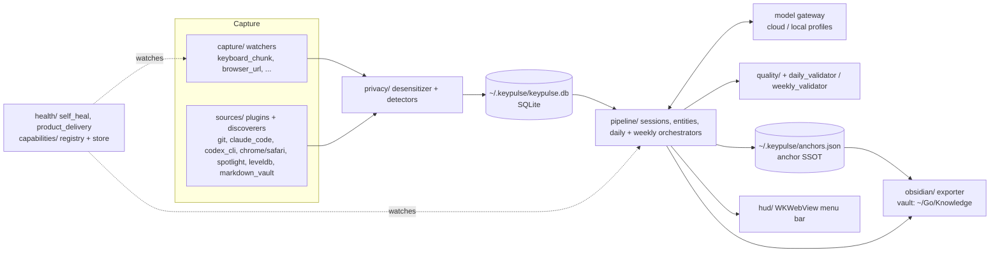

# System architecture

## Layers

## Entry points
- `keypulse/cli.py` — single click group `main` (~4.4k lines). Subgroups: `daily`, `weekly`, `obsidian`, `pipeline`, `eval`, `install`, `hud`, `model`, `config`, `session`, `sinks`. Hidden/dev commands live under `dev`.
- `app_main.py` + `setup_app.py` — py2app bundle entry (double-click routes to `hud start`).
- `integrations/launchd/` — plists for daemon, healthcheck, obsidian-sync (hourly + on-trigger).
- `Makefile` — `bootstrap`, `app`, `preflight`, `install`, `onboard`, `reload`.

## Module map (`keypulse/`)
- `capture/` live watchers; `sources/` batch data-source plugins; `privacy/` desensitization.
- `pipeline/` ~50 modules: orchestrators, entity extract/merge, principle distillation (L7), validators.
- `prompts/` — LLM prompt files; `loader.py` matches a prompt by frontmatter `capability:`; JSON schemas in `prompts/schemas/`.
- `obsidian/` export layout and quality gate; `hud/`; `health/`; `capabilities/`; `store/`; `services/`; `observability/`; `search/`.

## Docs layout (gotcha)
- ~100 files under `docs/` and `keypulse/prompts/` were **renamed with Chinese prefixes but the rename is uncommitted** (old paths show as `D`, new paths as `??`). Current working-tree names: `docs/说明-*`, `docs/设计-*`, `docs/记录-*`, `docs/评测-*`, `keypulse/prompts/备忘-*`.
- `CLAUDE.md` and `AGENTS.md` still cite old paths (e.g. `docs/golden-daily/2026-05-06-v4.md`). Current name: `docs/golden-daily/评测-2026-05-06-v4.md`.
- Also: `/Users/Harland/CLAUDE.md` (parent dir) describes a different project (qi-agent / T16A, `core/` tests) and will be loaded for this repo too.
