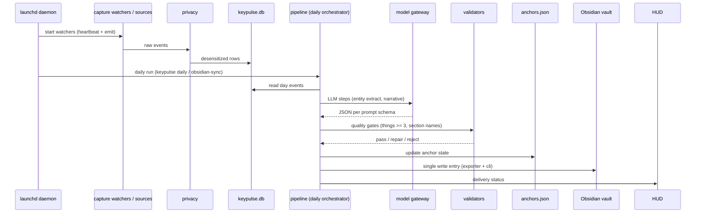

# Key flows

## Main pipeline (capture to output)

## Weekly
`keypulse weekly run` -> weekly orchestrator -> entity merge + L5 main narrative -> `weekly_validator` -> Obsidian `Weekly/`.

## Gotchas
- Daily is gated: `quality_gate` rejects thin output (thing_count < 3); a rejected run leaves the previous-day file visible (seen 2026-05-17, see `docs/记录-incident-2026-05-17-selfheal-loop.md`).
- Silent-failure history: 2026-05-14 `UnicodeDecodeError` removed a day's daily with no HUD error; fixed by M0 locale and M1 RunRecorder delivery ledger.
- TCC permissions: a reinstall changes the code-signing cdhash; onboarding must kick the daemon afterwards (see [[tcc-permission-refresh-on-install]]).
