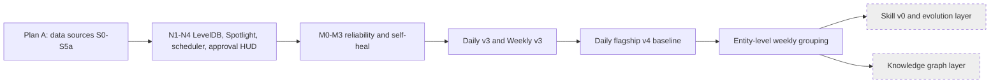

# Roadmap

No dates recorded: none can be grounded in code or git (**dates TODO, owner to confirm**). Status below comes from `docs/说明-EVOLUTION.md` and code grep.

## Direction change (2026-10-10)
KeyPulse is re-scoped to local memory + context infrastructure, MCP-first, for local AI IDEs. Details: [[keypulse-v1-local-memory-infra]].
- Refactor in place; `legacy-v0` tag is the baseline: [[refactor-in-place-with-legacy-tag]].
- Core does not embed an LLM: [[core-no-embedded-llm]].
- New schema + one-time importer; legacy daily/weekly/Obsidian get bug fixes only: [[legacy-data-new-schema-importer]].
- Open: V1 scope, acceptance criteria, first target IDE, and the items in [[v1-deferred-undecided-items]].
- Skill layer (P2) and knowledge graph are deprioritised: see [[skill-layer]], [[knowledge-graph-layer]].

Grey = designed, not implemented (no matching code found).

## Open issues
- Uncommitted docs/prompt renames (~100 files); decide whether to commit. CLAUDE.md still cites old names.
- `keypulse skill propose` and `eval skill` are placeholders (`cli.py` ~L3398). Skill propose has **no Gold Set yet**; CLAUDE.md requires one.
- Weekly baseline W19/W22 to be refreshed after content fixes (CLAUDE.md note).
- Test count and suite health not re-verified in this pass.
- `keypulse/prompts` files moved; confirm the loader still finds them by `capability:` after rename (not tested here).
- Legacy extraction blockers: [[legacy-extraction-blockers]].
