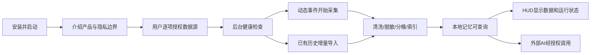
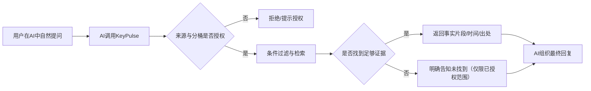

# KeyPulse V1 PRD｜开发基线 v1.2

> 文档版本：**v1.2 / 开发基线**（取代 v1.1 评审稿；同时取代 `docs/KeyPulse_V1_PRD.md`）  
> 更新日期：**2026-10-10**  
> 产品名称：**KeyPulse**  
> 产品阶段：**种子用户验证 → V1 基础能力闭环**  
> 目标平台：**macOS 优先**  
> 适用对象：产品、客户端、数据/算法、Agent 接口、交互、测试  
> 依据：当前 KeyPulse V1 产品基线，以及《座舱AI智能体产品需求文档（PRD）模板》的结构与交接粒度。

### v1.2 变更记录（2026-10-10，产品负责人拍板）

**A. 产品负责人决策（编号对应决策表 D13–D23）**

1. **键盘采集（决策1 / D13）**：F03 保持 P0，统一为「P0 + 用户显式 opt-in 开关（默认关）+ 只存过滤后的文本片段（chunk），不存逐键流」。实验阶段**脱敏/过滤完整度不是 P0 门槛**，所有承诺或度量脱敏完整度的表述改为「尽力而为（best-effort）、非阻断、P1 加固」。涉及：§1.3、§1.4、§3.2.2–3.2.4、§3.4.2–3.4.3、§3.10.3–3.10.4、§4.4、§5.2、AT07、§6.4、D02、D03。AT10 级联删除与 opt-in 开关原样保留。
2. **记忆抽取归属（决策2 / D14）**：抽取/蒸馏是消费端 AI IDE Agent 的职责；核心只做存储、规则去重/合并、检索。`commit_memory`、`update_memory`（最小写路径）由 P1 升为 **P0**；§3.9.3 Distill Worker 改为仅规则、核心内无 LLM；§3.6.3 候选来源改为「Agent 写入 + 规则捕获」；D06 关闭。涉及：§1.3 F08/F11/F12、§2.3 W04、§3.5.2–3.5.3、§3.6.3、§3.8.2、§3.9.3、§6.1、AT16、D06。
3. **MCP 鉴权（决策3 / D15）**：P0 最小方案 = 本地 token + 客户端白名单（每 Host 一个 AccessGrant 绑定该 token）。涉及：§3.5.2 AccessGrant、§3.8.3、§3.8.4、AT15。
4. **文档地位（决策4）**：本文为正式开发基线 v1.2，取代 `docs/KeyPulse_V1_PRD.md`；新增 D13–D17。
5. **评测归属（决策5 / D16）**：成功/评价口径由独立《Eval PRD》（`docs/KeyPulse_Eval_PRD.md` v1.0）定义；§5.3、§6.2、§6.4 的指标降为非约束候选目标（保留 P95 查询 ≤2s @10 万事件为候选）。涉及：§1.4、§5.3、§6.1–6.4、§7.2、§8.3–8.4、§9.3。
6. **多 Host（决策6 / D17）**：Claude、Codex、Cursor 均须在 V1 经**同一 MCP Server** 接入（每 Host 仅薄适配层/配置）；Claude/Codex 会话解析器（采集）与 MCP 消费相互独立。涉及：D05、§1.3 F05、§1.4、§3.3.2、§3.8、§6.1、§6.4、AT12、AT17。
7. **Windows（D18）**：V1 仍仅 macOS。新增架构约束：核心包不得 import macOS 专属库（AppKit / Quartz / ApplicationServices / objc / IOKit / Vision 等），平台代码仅限采集、HUD、启动/安装三层适配器，CI 以 import-linter 强制。Windows 重评触发条件见 D18。涉及：§1.1、§7.1、§7.3。
8. **聊天工具采集（D19）**：聊天 App 默认排除；用户可按 App 显式开启，开启后的屏幕（AX）内容入 Private 分桶；禁止本地聊天库解密；飞书/Slack 官方 OAuth 接口为 V1.1 试点。已知限制：V1 无工作聊天历史来源，W01 中的工作聊天部分仅能依赖用户显式开启后的屏幕采集。涉及：§1.3 F05、§1.4、§2.3、§3.3.2、§5.2、§6.1、§6.3 AT20、§7.1–7.2。
9. **数据库演进（D20）**：在现有 SQLite 库上以迁移 v20+ 演进，不新建 schema、不做一次性导入器；旧版在迁移外创建的表（llm_trigger_log、run_records）保持 legacy 所有，不属于核心 schema。涉及：§3.5.2、§7.1、§7.3。
10. **代码组织（D21）**：原地瘦身，不新建顶层 core 包；import-linter 禁止核心模块导入 pipeline / obsidian / quality / LLM 网关，并按 D18 禁止 macOS 专属库越界。涉及：§1.1、§7.1、§7.3。
11. **旧版日报/周报/Obsidian（D22）**：移出后台 daemon，保留为可选独立命令或定时任务，仅修 bug；daemon 只运行核心（采集、源同步、检索、MCP）。涉及：§1.1、§3.9、§4.1、§9.2。
12. **P0 范围对齐旧版（D23）**：Artifact 推迟 P1，P0 用事件 metadata 中的 artifact 字段；Session P0 仅窗口焦点会话，源派生会话推迟 P1；分桶 P0 按源默认 + 应用规则（复用旧 policies 表），不做内容分类，Temporary 及到期清理推迟 P1；控制面 P0 为全局暂停 + 按源开关，删除按源与时间范围级联，定时暂停与按桶/单条删除推迟 P1；AT10/G4 删除完整性门槛不变。涉及：§3.4.2、§3.5.2、§3.10.2。

**B. 审阅修订（独立判断，产品负责人可否决，逐条标注）**

- **(审阅修订) B1**：§3.7.3「已搜索范围」、§8.1 `coverage.note`、§1.2.2 流程图节点 H 改为只描述**本次调用已授权**范围，不得暗示未授权（尤其 Private）桶内容的存在或规模；§8.1 补充 `partial` 语义约束。
- **(审阅修订) B2**：W01 示例「只看昨天飞书」改为不依赖 IM 的来源示例；L01 去掉「聊天线索」对 IM 的隐含依赖；§3.3.2 明示飞书/微信仍为 V1.1 试点，数据模型不为其设特例，P0 验收不依赖它们。
- **(审阅修订) B3**：V1 仅 macOS 的口径保持不变（§1.1，无改动）。
- **(审阅修订) B4**：Agent 经 `commit_memory` 写入的 Memory 默认 `declared`，不得引用其 AccessGrant 无权读取的 Evidence，写入 Bucket 不得超出 Grant 范围（§3.6.3、§3.8.3）。
- **(审阅修订) B5**：Keyboard 开启界面必须明示「过滤为尽力而为、可能记录到敏感内容、返回云端 Host 时可能出站」（§3.2.2、§4.4）。
- **(审阅修订) B6**：用户**显式配置的 App/域名排除名单**不视为「脱敏」，仍须生效（新增 AT18，P0 功能验收）；KeyPulse 自身 token/Grant 凭据禁止出现在日志/审计/诊断包（§3.10.3）。
- **(审阅修订) B7**：`get_memory` 仍为 P1，P0 期间 Memory 命中经 `search_context` 返回（供 Agent 写前查重）（§3.8.2）。
- **(审阅修订) B8**：AT12（跨 Host 一致）由 P1 升 P0；新增 AT15–AT19；AT07 降为非阻断（后者属决策1的推论，前者为决策2/3/6的推论）。

**阅读说明**

- **【已确认】**：来自已达成共识的产品目标与边界，不建议在功能开发中自行改变。
- **【建议冻结】**：本次为研发交接补齐的明确规则、接口与验收口径；作为默认方案进入评审，评审确认后形成基线。
- **【待验证】**：依赖 macOS 权限、第三方格式/API、性能实测或种子用户反馈的内容，不应写成已经实现。
- **P0 / P1 / P2** 表示需求优先级，**不代表代码仓库当前实现状态**。现有组件的复用情况必须通过源码审计与冒烟测试单独确认。

---

## 一、产品基础信息

### 1.1 产品概述

| 项目 | 内容 |
|---|---|
| 产品名称 / 版本 | KeyPulse V1（macOS Local-first 个人数字记忆产品） |
| 一句话定位 | **KeyPulse 在本地持续保存和整理用户授权的数字活动，让现有 AI 随时找回事实、续接上下文，并逐步复用过去的经验。** |
| 适用平台 | **V1 macOS**；Windows / Linux 暂不列入 V1 交付范围；**架构约束（D18）**：核心包不得 import macOS 专属库，平台代码仅限采集 / HUD / 启动安装三层适配器（import-linter 在 CI 强制） |
| 主要用户 | 日常大量使用电脑、频繁切换任务或 AI 工具的人；优先验证 AI IDE/Coding Agent 用户，兼顾高信息密度的非开发岗位 |
| 核心场景 | **工作**：找回沟通细节/决策依据/项目进展，长期沉淀经验；**生活**：找回聊天、购物、旅行、办事等零散信息，复用过去经验 |
| 核心差异 | 同时覆盖**实时动态痕迹**与**既有结构化历史**，统一形成带来源的本地长期记忆，而不只依赖 AI 对话记录 |
| 主要消费入口 | Claude / Codex / Cursor 等具备可用连接方式的外部 AI；KeyPulse 本地 HUD 负责存在感、状态、管理和快速检索 |
| 数据立场 | **本地优先、按源授权、分桶隔离、来源可追溯、随时暂停和删除** |
| 当前非目标 | 重型内容 Dashboard、以 Obsidian 为主前端、重新开发通用聊天助手、后台实时调用大模型分析全部行为 |

#### 1.1.1 用户画像

| 用户类型 | 数字行为特点 | 最典型的损失 | 首要价值 |
|---|---|---|---|
| AI 开发/研发用户 | Claude/Codex/Cursor、Git、终端、文档跨工具切换 | 任务交接要重讲背景；排错结论与失败尝试丢失 | 续接任务、找回证据、跨 AI 记忆 |
| 产品/研究/项目用户 | IM、浏览器、文件、会议材料高频切换 | 讨论过的规则、数值、决策原因难以定位 | 模糊找回、时间/人物/项目串联 |
| 生活信息密集用户 | 购物、出游、家庭事务、网站与聊天交织 | 链接、型号、办理流程、经验散落 | 生活事实找回、经验复用 |

> **用户画像是目标假设，不是已验证结论。** V1 种子问卷与访谈应重点测痛点发生频率、授权接受度和安装意愿。

### 1.2 核心用户体验流程图

#### 1.2.1 首次使用：安装 → 授权 → 建库 → 可查询



- 未授权某一类数据不阻断其他已授权源；首启无有效源时提示如何开启，但不擅自申请全部权限。
- 首次导入历史不要求一次扫完：**可查询已完成部分**，其余继续增量同步；HUD 显示导入进度。
- 采集和索引不等于“大模型理解”：重型推理不进入始终运行的采集关键路径。

#### 1.2.2 日常找回：用户提问 → 取证 → 回答



#### 1.2.3 长期沉淀：事实 → 记忆 → 经验复用


> **【已确认】** KeyPulse 的首要责任是数据与 Memory 质量；外部 AI 承担复杂推理与 Skill 制作。Skill 自动发现/批量生成属于后续增强，不强塞进 V1 首发。

### 1.3 核心功能清单

**优先级定义**：P0 = V1 核心闭环必须；P1 = 强相关增强；P2 = 后续演化能力。  
**模块编号**与第三章一一对应，便于研发拆任务和测试按条追踪。

| 模块 | 二级功能 / 编号 | 优先级 | 功能描述（手段 → 痛点 → 效果） | 用户价值 | 关键依赖 |
|---|---|---|---|---|---|
| 启动与授权 | F01 首次安装/授权/源配置 | P0 | 按源授权、配置采集范围，避免未知采集与首次失败 | 可控地开始使用 | macOS 权限、Client |
| 动态采集 | F02 Window / AX / App Activity | P0 | 采集经授权的应用与活动上下文，补足 AI 聊天之外的工作痕迹 | 不错过关键线索 | Accessibility、应用过滤 |
| 动态采集 | F03 Keyboard / Clipboard / Browser 活动 | P0 | Keyboard 须用户显式开启（opt-in，默认关），只存过滤后的文本片段、不存逐键流；Clipboard / Browser 在授权范围内捕捉；敏感过滤尽力而为（P1 加固，非阻断） | 找回原本留不下的细节 | 本地采集器、尽力过滤 |
| 结构化数据接入 | F04 Claude / Codex / Git / Terminal / Files / Browser History | P0 | 增量导入已有历史，弥补动态采集不完整 | 数据更完整、可追溯 | Source Adapter、增量游标 |
| 结构化数据接入 | F05 Cursor / 其他 AI、飞书/微信 | P1 | 在访问方式合法可行时扩展高价值来源（指数据源解析器；Cursor 作为 MCP Host 的接入仍为 P0，见 D05）；飞书/Slack 仅经官方接口 + 用户 OAuth 做 V1.1 试点，不做本地聊天库解密，聊天 App 默认排除（D19） | 工作/生活跨度扩大 | 官方接口/本地格式/权限核验 |
| 数据处理 | F06 清洗/去噪/去重/敏感处理（尽力而为）/分桶 | P0 | 多源数据统一处理后入库，减少噪声和隐私暴露 | 可用且可控 | 事件模型、隐私策略 |
| 本地数据底座 | F07 统一事件库/全文检索/来源索引 | P0 | 保留时间、来源、正文与引用位置，支持定位原文 | 检索可信 | SQLite、FTS、Migration |
| Memory | F08 情景/语义/基础工作记忆 | P0 | 把事件整理成事实、项目、决策等对象，避免只会全文匹配 | 可直接问“发生过什么” | 数据模型、规则整理、Agent 经 commit_memory 写入 |
| Memory | F09 冲突/更新/结果验证/衰减 | P1 | 处理记忆过期及前后矛盾，减少旧信息被当成当前事实 | 长期记忆可信 | 证据关联、生命周期 |
| 记忆服务 | F10 Search / Recall / Timeline / Evidence | P0 | 按模糊线索、时间、来源和项目找回，返回可核对片段 | 减少重复翻找 | DB、索引、权限引擎 |
| AI 连接 | F11 MCP stdio、只读工具与 commit_memory / update_memory 写入 | P0 | Claude / Codex / Cursor 经同一 MCP Server，在用户授权后查询并（带 Evidence 引用）写入同一个数据底座 | 无需重复介绍背景 | MCP、Client 配置、本地 token + 客户端白名单 |
| AI 连接 | F12 CLI / Local API / 其他 Host 适配 | P1 | 扩展接入方式与更多 Host（Agent 写回已随 F11 进入 P0），保障跨工具连续使用 | 连接更广、记忆更准 | 接口契约、鉴权 |
| 本地 Client | F13 HUD / 健康与数据状态 | P0 | 显示实际采集/索引/连接/异常状态，解决后台死亡不可见 | 用户信任与掌控 | Daemon、health、IPC |
| 用户控制 | F14 暂停/删除/黑名单/权限/访问审计 | P0 | 提供清晰的控制开关与本地权限边界 | 愿意长期安装 | 访问控制、存储 |
| 经验演化 | F15 失败案例/方法/原则/Skill 支撑 | P2 | 聚合高价值证据供 AI 蒸馏方法与 Skill | 长期能力积累 | Memory 生命周期、外部 AI |

### 1.4 产品环境及技术依赖

| 类别 | 依赖项 | 具体要求 | 状态/备注 |
|---|---|---|---|
| 平台 | macOS 版本与架构 | 明确最低版本、Intel/Apple Silicon 支持边界；CI/测试机覆盖目标组合 | **待工程确认** |
| OS 能力 | Accessibility / Window / App 信息 | 按功能申请系统权限；拒绝后相应源降级，不影响其他源 | 需权限适配 |
| OS 能力 | 后台启动与恢复 | 登录启动、崩溃恢复、休眠唤醒、单实例、健康检查 | 可考虑 launchd；具体方案工程评审 |
| 历史源 | AI IDE / CLI 数据 | 只处理用户授权且合法可读取的本机记录；格式可能随版本变化 | 适配器逐项验证 |
| 通信源 | 飞书 / 微信 | 受平台接口、加密、使用条款与用户授权限制；不能承诺全量自动读取；**不内置本地聊天库解密（长期原则，不限 V1）**（违反 ToS、脆弱、与信任定位冲突）；飞书/Slack 官方 OAuth 接口为 V1.1 试点 | V1.1 试点（D19）；微信仅可依赖用户显式开启后的屏幕采集 |
| 存储 | SQLite / 索引 | 本地持久化、迁移、数据完整性、增量游标与备份恢复策略 | V1 基础能力 |
| AI 调用 | MCP / CLI | Host 接入协议因产品而异；**不承诺所有 AI 天然支持 MCP**；V1 要求 Claude / Codex / Cursor 经同一 MCP Server 接入（D05） | 首发按 Host 验证 |
| 网络 | 离线使用 | 采集、索引、本地检索原则上离线可工作；联网由 AI Host 自身决定 | P0 |
| 安全 | 敏感信息处理 | 源开关、采集排除、授权与删除、最小数据披露、外部 AI 提醒；敏感内容过滤为尽力而为（D13） | P0（过滤完整度非阻断） |
| 性能 | CPU / 内存 / 磁盘 | 需通过真实设备基准测试冻结数值，不能在 PRD 中假定“几 MB” | **待实测；判定口径由《Eval PRD》（`docs/KeyPulse_Eval_PRD.md` v1.0）定义** |

---

## 二、产品定位、场景与目标

### 2.1 产品定位与目标

**【已确认】** KeyPulse 解决的是：**个人在电脑上产生的事实、沟通、操作和经验散落于多款软件，既容易遗失，也难以让正在使用的 AI 可靠复用。**

它不是一款要求用户专门整理内容的软件。用户继续正常工作和生活，KeyPulse 在后台捕获与接入**授权数据**，在本地形成可查询、可管理、可追溯的个人记忆，并通过标准接口提供给 AI。

**三层架构及责任边界**：

| 层级 | KeyPulse 责任 | 不应承担 |
|---|---|---|
| L1 · Personal Data | 动态采集、历史源接入、清洗/脱敏、分类分桶、本地保存 | 为了追求完整度而越权记录全部内容 |
| L2 · Memory & Context | 事件/事实/记忆模型、索引、查找、证据、更新、访问控制、HUD、服务接口 | 无证据编造个人历史或强制用户维护知识库 |
| L3 · AI Application | 向现有 AI 暴露受控上下文，支持查找/续接/总结/经验复用 | 重新造一个全功能 Agent 聊天产品 |

Brain / Memmy 一类产品所验证的**长期 Memory、决策/任务/偏好结构化、跨 Agent 共享和记忆生命周期**均属于 KeyPulse L2 规划内能力；不把竞品名称当作技术架构或依赖。

### 2.2 用户与具体使用场景

顶层只有**工作**与**生活**两个领域；每个领域都分别覆盖**找回来**与**沉淀复用**。

| 编号 | 用户 / 场景 | 触发时机 | 用户说法 | 产品需要提供的结果 | 优先级 |
|---|---|---|---|---|---|
| W01 | 产品/研发找回沟通细节 | 次日开会前 | “昨天和小李聊的那个框架叫什么？” | 相关时间片段、原词、来源、上下文；未知时明确未找到 | P0 |
| W02 | 查找产品原则/数字 | 写需求或评审 | “这个功能当时边界是怎么定的？” | 对应版本、讨论时间、原始表述与变更记录 | P0 |
| W03 | 追溯技术失败/决策 | 再次遇到旧问题 | “我们为什么没用方案 A？” | 候选方案、失败证据、最终决定，区分推断与事实 | P0/P1 |
| W04 | 跨 AI 继续任务 | Claude 切 Codex | “接着昨天这个项目做。” | 最近目标、文件、变更、未完成事项与来源；由 AI 主机执行下一步 | P1 |
| W05 | 长期方法蒸馏 | 项目复盘/主动提问 | “总结过去半年我的 Agent 评测经验。” | 多次事件/失败/决定的证据包，供 AI 提炼 Method/Skill | P2 |
| L01 | 生活链接/商品找回 | 再次购物 | “之前买过的球线是什么型号？” | 商品名称、页面、时间或对应浏览/AI 会话线索 | P0 |
| L02 | 办事经验找回 | 再次办理签证 | “上次办澳洲签证用了哪些材料？” | 过去自己的步骤/资料/坑，注明信息时间，**不等同最新官方政策** | P0 |
| L03 | 生活事务习惯沉淀 | 周期性重复活动 | “以前做车辆保养时常选哪种材料？” | 历史偏好与例外、来源，不代替专业安全判断 | P1/P2 |

### 2.3 典型用户旅程及边界

#### W01：模糊找回同事讨论细节

1. 前一天用户在获授权的应用中沟通，KeyPulse 捕获片段或导入已有记录，保留时间与来源。
2. 当日用户向外部 AI 提问；AI 调用 `search_context`，携带时间、人名别名、关键词等线索。
3. KeyPulse 在**当前 Agent 可访问的 Bucket / Source** 内检索，返回匹配片段、来源、相关程度与打开原文的定位信息（若可定位）。
4. AI 组织简短答案，提示证据。找不到时不得用其他项目近似词“猜一个”。
5. 用户可进一步限定“只看昨天的 Claude 会话”“不要私人记录”。

**成功标准**：用户能依据结果确认具体细节；关键内容有可核验来源。

> P0 的 W01 仅依赖 Claude / Codex / Git / Terminal / Files / Browser 等 P0 来源与动态采集；飞书/微信为 V1.1 试点，P0 不依赖、数据模型也不为其设特例。
> **已知限制（D19 d）**：V1 没有工作聊天历史来源，仅依赖用户对某聊天 App 显式开启后的屏幕（AX）采集，W01 的同事讨论细节找回因此受限。产品宣传不得声称可读取微信/飞书历史。

#### W04：跨 AI 续接项目

1. KeyPulse 已记录前一个 AI 会话、Git 变更与相关文件事件。
2. 新 AI 读取同一份受控 Context；同名不同项目须消歧。
3. 返回“当前已知事实 / 上次活动 / 未完成事项 / 尚未验证的结论”，其中未验证项不得写成完成。
4. 新 AI 继续执行。其产出可由 Host 经 `commit_memory`（P0）写回，须带 Evidence 引用并受 AccessGrant 约束；**抽取由 Host 完成，KeyPulse 核心不做；V1 不承诺所有 Host 都会自动写回**。

#### L02：生活经验找回

1. 用户曾浏览官方签证网站、整理文件或记录办事对话。
2. KeyPulse 返回历史材料清单、搜索来源和发生时间。
3. 外部 AI 若要给出**今天适用的政策**，需另行核验官方最新信息，不能把两年前的个人经历当法规。

### 2.4 产品原则与需求决策约束

1. **持续可采集**：后台服务常驻，关键瞬时数据能在授权范围内留存；不以 Always-on LLM 为前提。
2. **先保全证据，再生成记忆**：摘要可重建，原始可信证据的来源链不能丢。
3. **数据最小化**：持续采集并不意味着无限制记录；按应用/源/字段限制并允许排除。
4. **本地数据所有权**：默认本地落盘；外部 AI 只获取用户允许的最小必要内容。
5. **Memory 是会变化的**：支持新事实覆盖旧状态，同时保留历史与冲突来源。
6. **使用入口在现有 AI，控制入口在 HUD**：HUD 解决运行可见、管理与必要快速搜索，不变成信息消费主站。
7. **不把外部平台可访问性当作理所当然**：如微信、飞书、Cursor 等具体接入要逐个验收。

---

## 三、核心功能模块需求

> 本章按功能 ID 拆解**功能定义 → 触发/处理/反馈/退出 → 子功能表 → 异常处理 → 验收要点**。表内为面向实现的建议规则；标注“待确认”的条目进入第七章待决策清单。

### 3.1 F01 首次安装、初始化与授权（P0）

#### 3.1.1 功能定义

首次启动时完成本地数据库初始化、基础自检、数据源选择与权限说明，让用户清楚知道**会收什么、从哪儿收、存在哪里、如何停用**。

#### 3.1.2 功能逻辑

| 子功能 | 触发 → 处理 → 反馈/退出 | 界面/数据要求 | 依赖 |
|---|---|---|---|
| 首启引导 | 首次启动 → 呈现产品价值与数据边界 → 选择来源 → 完成初始化 | 不使用“全部授权”作为唯一继续方式；说明不同来源区别 | Client、配置文件 |
| Source 配置 | 用户勾选单源 → 说明访问内容、保留方式与权限 → 授权成功启用 | 每源有单独开关、状态、上次同步时间 | Source Registry |
| OS 权限 | 用户启用需要权限的源 → 引导至系统设置 → 返回自动检测 | 被拒绝时标记“等待授权”，展示修复路径 | macOS 权限 |
| 首次导入 | 获得读取许可 → 识别已有记录 → 分批增量导入 | 显示“正在导入、可先使用已完成内容”；支持暂停 | Indexer、Store |
| 健康检查 | 初始化/重启 → 检查 DB、磁盘、权限、采集器与接口 | 成功显示 Ready；失败列明具体模块 | Health 模块 |

#### 3.1.3 异常处理

- OS 权限拒绝或撤销：**立即停止相应源的内容读取**，其余已授权源继续；HUD 给出“未授权/已撤销”，不循环弹窗。
- 数据库初始化失败：显示“数据不可用”及修复/查看日志入口，不静默进入正常态。
- 导入中异常退出：保存游标和已入库数据，下次恢复；不得每次全量重复写入。

#### 3.1.4 验收

- 新用户仅启用 Claude 历史也能完成首启与查询；其他 OS 权限未给出不影响该来源。
- 撤销一项系统权限后，该来源在下一次健康检测前后均不得继续采集其内容。
- 首次导入中强制退出并重启，已入库记录不重复，UI 可见恢复状态。

### 3.2 F02 / F03 动态行为采集（P0）

#### 3.2.1 功能定义

在用户授权并开启的范围内持续获取**现成历史文件通常捕捉不到的动态数字线索**，包括前台应用/窗口、辅助功能可访问的文本线索、剪贴板、部分键盘输入片段与浏览器活动。

> **【已确认】** 动态采集与 Always-on 是 KeyPulse 的核心能力，不从产品中删除。  
> **【建议冻结】** 进程默认常驻，**高敏文本来源逐项选择授权**；即使进程正常运行，也不代表所有源默认开启。

#### 3.2.2 功能逻辑

| 子功能 | 触发 → 处理 → 反馈/退出 | 字段 / 数据流 | 依赖/限制 |
|---|---|---|---|
| App / Window 事件 | 前台应用/窗口切换 → 记录时间、App 标识、窗口标题（过滤后） → 写事件 | `source / app_id / window_title / started_at / ended_at` | macOS API；可能受辅助功能权限限制 |
| AX 文本线索 | 窗口文本变化且源已授权 → 读取可访问文本 → 敏感过滤 → 合并事件 | 文本摘要/片段及所属窗口 | AX 并不保证所有 App 文本可访问 |
| Keyboard 片段 | 用户在设置中显式开启 Keyboard 开关（opt-in，默认关；可按 App 限定）→ 捕获输入文本 → 尽力过滤 → 写入文本片段（chunk） | 时间、App、文本片段、过滤标签（如有）；**只存过滤后的文本片段，不保存逐键原始按键流** | 高敏；尽力排除密码框（含系统安全输入）、验证码、私密 App；过滤为 best-effort，非 P0 阻断 |
| Clipboard | 剪贴板变化且开启 → 识别文本/URL 等类型 → 去重/过滤 → 记录 | 内容类别、文本/URL、来源时间；不采集不支持类型 | 敏感字段、重复粘贴 |
| Browser 活动 | 可访问的浏览器事件/历史变化 → 提取 URL、标题、时间 → 整理归档 | 域名、标题、URL、访问时间 | 不承诺获取全部页面正文 |
| Session 切分 | 同 App/相近时间片段合并 → 形成活动序列 | `session_id / event_ids / time_range` | P0 仅规则分段；不猜全部任务意图 |
| 暂停与恢复 | 用户 Pause/系统权限撤销 → 即刻停止内容采集；Resume → 重新健康检查 | `source_state / reason / timestamp` | HUD、Collector |

**采集与隐私规则（V1 不可绕过）**

1. **先过滤后持久化（尽力而为）**：检测到密码输入、验证码、支付字段、明确排除的 App/域名/窗口时，默认不持久化正文；实验阶段该过滤为 best-effort，**不作为 P0 发布阻断条件**，完整度与漏过滤率加固列 P1。**用户显式配置的排除名单仍须生效。**
2. 无法确定字段敏感性时，对高风险来源优先采用**跳过内容、仅保留非敏元数据**的降级策略（尽力）；不能宣称脱敏 100% 准确。
3. 用户暂停后既不写内容，也不在缓存中继续积累待恢复的敏感原文；可只保留必要、无内容的健康日志。
4. 用户应能设置**应用/域名排除列表**。不采集系统安全输入、隐私浏览等明确禁止场景（具体可检测范围由工程验证）。
5. **【已确认·D13】** Keyboard 为 P0，且仅在用户显式开启开关后采集，保存经过滤的文本片段；开启界面须明示“过滤为尽力而为，可能记录到敏感内容，返回云端 Host 时可能出站”。保存时长随 D08 分层保留；不能借“本地”自动推导为无限采集许可。

#### 3.2.3 异常处理

| 异常 | 系统行为 | 用户反馈 |
|---|---|---|
| 特定 App 无法通过 AX 读取文本 | 只保存可用窗口元数据，不生成虚构正文 | Source 详情显示“该 App 仅支持活动记录” |
| 剪贴板内容重复/超大 | 使用哈希去重和长度上限，跳过大对象 | 不弹通知；在诊断页可见跳过统计 |
| 系统休眠/锁屏 | 停止活动内容采集，唤醒后重新检查权限与状态 | HUD 显示恢复后的最近成功时间 |
| 单个 Collector 崩溃 | 隔离故障并依策略重启，记录最后成功事件 | 连续失败升级为 Warning / Error |
| 敏感过滤漏判/误判 | 尽力阻断已识别的高风险片段写入；漏过滤时支持用户发现后删除原文/索引/派生记忆 | 隐私中心有明确操作入口 |

#### 3.2.4 验收

- 开/关每个来源后，事件写入与状态按开关变化；Pause 后内容事件写入停止。
- 测试密码框、验证码、隐私场景：记录过滤命中/漏过滤情况（best-effort，**非阻断**，缺陷登记为 P1 加固）；**用户显式排除的 App/域名**必须在入库前被跳过（AT18）。
- Keyboard 开关默认关闭，开启前展示风险说明；关闭后不再写入键盘片段；库中只有文本片段、无逐键流（AT19）。
- 采集器失败/恢复可被 HUD 看见；用户不应连续几天以为数据仍在正常更新。
- 对不可读取 App，系统只标记不支持，**不得假造“已完整采集”**。

### 3.3 F04 / F05 结构化数据源接入（P0 / P1）

#### 3.3.1 功能定义

将软件已经留存的历史记录作为独立数据源导入，和动态采集统一检索；重点支持本机 Claude/Codex 会话、Git、终端历史、浏览器历史和文档，不依赖全天截屏或 OCR 重建这些已有事实。

#### 3.3.2 数据源矩阵

| Source | V1 目标输入 | 采集模式 | 基本证据 | 优先级 / 约束 |
|---|---|---|---|---|
| Claude Code / Claude 本地可访问记录 | 对话、工具调用、时间与项目线索 | 扫描历史 + 增量游标/事件 | 会话/文件定位 | P0；实际可读格式按版本验证 |
| Codex 本地记录 | 会话、工具动作、工作目录、时间 | 同上 | 会话/任务定位 | P0；格式按版本验证 |
| Git | 分支、提交、变更文件、提交消息 | 仓库扫描 + 增量 | commit hash、仓库路径 | P0 |
| Terminal | shell history、命令结束事件（可用时） | 历史增量/Hook | 命令、时间、退出状态（能拿到时） | P0；不保证历史命令有完整时间/结果 |
| Browser History | URL、标题、访问时间 | 本地结构化读取 | URL、访问时间 | P0；按浏览器权限/格式验证 |
| Files / Markdown | 文件名、修改、文本、路径 | 扫描/变更同步 | 路径、修改时间、内容片段 | P0；文件类型和范围白名单 |
| Cursor / 其他 IDE | 可读取的会话与项目元数据 | 适配器 | Session / workspace | P1；取决于产品数据格式与权限（此处指数据源解析器；Cursor 作为 MCP Host 的接入为 P0，见 D05） |
| 飞书 / 微信 | 合法、用户可授权且技术可访问的消息/记录 | 官方 API（OAuth）/用户导入（视可行性）；不含本地聊天库解密 | 消息/文件来源 | **V1.1 试点，仅限官方接口（飞书/Slack，用户 OAuth）；不保证全量/自动读取**；聊天 App 默认排除，用户可按 App 显式开启（§5.2，D19 a–c）；P0 与数据模型不为其设特例（经通用 Adapter → Event 接入），P0 验收不依赖飞书/微信 |

#### 3.3.3 功能逻辑

| 子功能 | 触发 → 处理 → 反馈/退出 | 接口/数据 | 依赖 |
|---|---|---|---|
| Source Discoverer | 启用来源 → 发现路径/账户/仓库 → 告知可访问范围 | Source 配置与 capability | 文件权限 |
| 首次导入 | 选定范围 → 批量解析 → 写统一 Event → 建索引 | `source_id / external_id / cursor` | Adapter、Indexer |
| 增量同步 | 文件/游标变化或计划调度 → 只读新增/变更 → 去重入库 | last_success / sync_cursor | Scheduler |
| 内容变更 | 原文件更新/删除 → 更新索引状态及历史版本关联 | provenance/invalidated_at | Store |
| 失败隔离 | 某 Adapter 报错 → 保留成功源 → 单源重试 | error_code、retry_count | Health |

**统一要求**：同一事实同时来自 Claude 工具调用、Git commit 和文件变化时，保留多个来源关联，而不是删到只剩某一条没有出处的摘要。

#### 3.3.4 异常处理及验收

- 历史文件不存在：状态 `Not available`，不是 `Broken`；用户可跳过。
- 来源升级导致解析失败：停止该源新数据入库，保留旧数据，报告适配器版本问题。
- 源内容删除：不得静默继续将该文件当成当前有效；对派生记忆做无效/待核验标记。
- **验收**：重复扫描同一个 Source，不新增重复记录；增量加入新会话/commit 后可查到对应出处；单源损坏不影响其他源。

### 3.4 F06 数据清洗、脱敏与分桶（P0）

#### 3.4.1 功能定义

把不同输入统一成可检索、可追溯、可控共享的数据对象；严格区分原始数据、标准化事件、派生记忆和可向外部 AI 返回的内容。

#### 3.4.2 处理流程

```text
Source Input
  → Source Permission Gate
  → Sensitive Filter / App-Domain Exclusion
  → Normalize (time/source/type)
  → Dedup / Merge / Sessionize
  → Bucket + Sensitivity Tag
  → Persistent Event + Provenance
  → Index / Memory Candidate
```

| 子功能 | 规则与逻辑 | 输出 / 约束 |
|---|---|---|
| 统一时间 | 保留原始时区/原始时间（如有）及统一 UTC 时间 | 支持“昨天”“上周”按用户本地时区过滤 |
| 内容归一 | 对话、命令、网页、文件分别规范字段；不要把所有东西转成同一种纯文本 | `event_type`、`source_type`、结构化 payload |
| 去重 | 优先 external id；次选内容哈希 + 来源 + 时间窗口；不能仅以相同正文认定重复 | 重复导入不膨胀，跨源证据不断链 |
| 脱敏（尽力而为） | 秘钥、密码、验证码、金融敏感片段等按规则尽力过滤/丢弃/掩码；实验阶段不设完整度门槛，P1 加固 | 敏感处理状态与过滤原因；已识别的原始秘钥不进索引和日志 |
| 分桶 | 最少支持 Work / Personal / Private / Financial / Temporary；允许用户改分类。**P0 分桶 = 按源默认 + 应用规则（复用旧 policies 表），不做内容分类；Temporary 为 P1（D23）** | 默认访问策略可按桶独立设置 |
| 项目/人物标记 | P0 基于明确目录/来源映射与用户指定规则；P1 再做跨源推断 | 不确定归属标记 `unclassified` |
| 数据完整性 | Source → Event → Memory 维持 ID 关联，支持从答案定位原文 | 原文失效后必须可识别 |

**【建议冻结】Bucket 访问默认策略**

- `Work`、`Personal`：**仅对明确授权的 Agent/连接器开放**，不是安装后自动外发。
- `Private`、`Financial`：默认拒绝第三方 AI 查询；用户每次明确授权才允许按范围访问。
- `Temporary`：按用户设置的到期时间清理，清理涵盖索引与其派生对象。**P1 能力（D23）**，P0 不实现 Temporary 到期清理。
- 无法识别的高敏内容：采用更严格默认权限；来源不确定的文本不得自动放到低敏可共享桶。

#### 3.4.3 异常处理及验收

- 数据类型异常或来源越界：阻断该内容持久化并记录不含正文的诊断事件；敏感过滤自身失败按尽力而为处理（记录不含正文的诊断事件，不阻断入库管线，P1 加固）。
- 用户变更 Bucket：新权限立即作用于搜索和 AI 调用；已生成的缓存需失效。
- **验收**：针对相同关键词，获授权 Work 与未获授权 Private 混合命中时，Agent **仅得到 Work 内容**，不得通过摘要、统计或报错泄露 Private 命中存在与否。

### 3.5 F07 本地事件库、索引与来源链（P0）

#### 3.5.1 功能定义

把 KeyPulse 建成可长期运行的个人本地数据库，而不是只有日报缓存或自然语言片段；所有可查询事实须能指向原始证据。

#### 3.5.2 数据对象（逻辑模型，不限定物理表名）

| 对象 | 必要字段（建议） | 说明 |
|---|---|---|
| `Source` | id、type、locator、capability、enabled、last_sync、health | 数据来源注册与运行状态 |
| `Event` | id、source_id、external_id、occurred_at、ingested_at、kind、bucket_id、sensitivity、payload_ref | 真实发生的最小可追溯记录 |
| `Conversation` / `Session` | id、time_range、app、participants?、event_ids、workspace? | 会话或活动片段；未知字段可以为空 |
| `Artifact` | id、type、path/url、version/hash、modified_at、event_ids | 文件、页面、提交等工作/生活产物 |
| `Evidence` | id、event_id、locator、offset/line、content_hash、available | 指向原始出处的最小证据单元 |
| `Memory` | id、type、subject、assertion、status、valid_from/to、updated_at、confidence、bucket_id、evidence_ids、created_by（principal / rule） | 具有生命周期的事实/状态/经验 |
| `AccessGrant` | principal、client_id（白名单项）、token_hash、scope（Bucket/Source/操作，含 read / write）、purpose、created_at、expires_at、revoked_at | AI Host/用户授予的权限；每 Host 一条，绑定该 Host 的本地 token（仅存哈希），见 §3.8.3 |
| `SyncCursor` | source_id、cursor、last_success、last_error | 增量同步与重试 |

> **实现映射（D20）**：在现有 SQLite 库上以迁移 v20+ 演进；Event 对应现有 raw_events（补 source_id / external_id / bucket / kind），Session 对应现有 sessions（P0 仅窗口级），Artifact 为 P1（P0 用事件 metadata 中的 artifact 字段），Source / Evidence / Memory / AccessGrant / SyncCursor / 审计为新增表。

`Memory.assertion` 与 `Evidence` 必须**分离**：用户修改记忆解释不应篡改历史事件；证据变更必须可追溯。

#### 3.5.3 读取/写入逻辑

1. 原始采集/导入事件获得稳定 ID，在事务内写入，并将可搜索字段加入 FTS 索引。
2. 关联 Session、Artifact 和 Evidence。必要时按规则生成基础 Memory；核心内不含 LLM 抽取/蒸馏（D06）。
3. 同一内容在多源发现时做 `related_evidence` 关联；保留不同来源和发生时间。
4. 用户主动删除时执行可验证的级联处理：正文、FTS、派生记忆、可恢复缓存按保留策略处理；SQLite 物理空间回收/备份清理策略工程评审。
5. 迁移必须有版本号与失败回滚/备份策略。

#### 3.5.4 异常处理及验收

| 异常 | 预期行为 |
|---|---|
| 数据库锁或并发写入 | 单写入协调/事务重试，不丢失已确认入队事件；多 Host 查询不阻塞采集过久 |
| 磁盘空间不足 | 停止内容写入、保护现有库；HUD 显示 Error，避免宣称正常 |
| DB 损坏 | 健康检查报告损坏；只读诊断/恢复，不静默重建空库覆盖原数据 |
| 索引不一致 | 支持重建索引并报告进度；在重建期间告知检索覆盖不完整 |

**验收**：能针对一条搜索命中定位 `Source → Event → Evidence`；重复运行迁移不破坏数据；重建 FTS 后结果与主库一致。

### 3.6 F08 / F09 Memory 类型与生命周期（P0 / P1）

#### 3.6.1 功能定义

在完整事件的基础上维护 Brain/Memmy 类产品已验证的长期记忆能力：**发生过什么、确认了什么、当前做到了哪里、过去为什么成功或失败**。记忆有来源、状态和更新规则。

#### 3.6.2 Memory 分类

| 类别 | 含义 | 示例 | 版本 |
|---|---|---|---|
| `Episodic` 情景记忆 | 发生过的会话/动作/事件 | “10/8 跑过一次模型测试” | P0 |
| `Semantic` 语义记忆 | 可长期引用的事实、定义、偏好 | “功能 A 的原则定义” | P0 |
| `Operational` 任务状态记忆 | Project、Task、Decision、Outcome、Preference、Artifact 等 | “决定先修路由，流式需复核” | P0 基础对象；P1 更新闭环 |
| `Experience` 经验记忆 | Failed Attempt、Lesson、Workflow、Heuristic、Principle、Method | “遇到该故障应先排查 X” | P2 深化 |

#### 3.6.3 Memory 创建与更新规则

| 子功能 | 规则 | 结果 |
|---|---|---|
| 候选创建 | 候选仅来自两类：① AI Host 经 `commit_memory` 写入（必须带 Evidence 引用）；② 核心内基于规则的捕获（显式用户确认、可信结构化事件，如 Git commit / 会话元数据）。**核心内不做模型/LLM 抽取** | 可审阅/可撤销，标注来源与写入方（`created_by`） |
| 状态区分 | `observed`（系统观察）、`declared`（用户/AI 陈述）、`inferred`（推断）分开记录 | “用户说完成”不等于测试已通过 |
| 新旧事实 | 对有时间性的事实保留 `valid_from/to`；更新当前状态时旧事实转历史 | 旧方案不会覆盖新方案 |
| 冲突处理 | 来源矛盾时保留双方 Evidence，标为 `conflicted` 或 `needs_review` | 不随机选一个给 AI 当事实 |
| 结果验证 | 例如 Decision → Git/测试结果 → Outcome 关联 | P1；支持后续追溯 |
| 记忆合并 | 核心按规则合并（相同 subject + assertion 哈希、Evidence 重叠），引用列表与时间信息不丢；语义层面的判重/改写由 Host 经 `update_memory` 完成 | 减少检索噪声 |
| 衰减/归档 | 对过期、低价值内容降低检索权重；未经配置不擅自删除核心历史 | P1；策略可控 |
| 用户修正 | 用户标记错误/更改事实 → 更新记忆并保留变更历史 | 减少持续“记错” |

**禁止行为**：不得仅凭模型生成一条没有来源的“用户习惯”；不得把“上次用过某个品牌”直接推断为“始终喜欢该品牌”；不得把 `inferred` 结果伪装成 `observed`。

**Agent 写入约束（审阅修订）**：经 `commit_memory` 写入的记忆默认 `declared`；不得引用该 Host 的 AccessGrant 无权读取的 Evidence；无有效 Evidence 的提交一律拒绝。

#### 3.6.4 异常处理及验收

- 重复 Memory 合并失败：允许并存并降低权重，不得删除独立 Evidence。
- 当前事实缺证据或出现冲突：按“不确定/待核验”返回，不能悄悄定案。
- 用户删除来源：关联 Memory 标记证据失效，依据删除策略清除派生内容。
- **验收**：同一项目“方案 A → 方案 B”的版本变化能按时间检索；AI 查询当前决策时，不得将 A 当最新决定。

### 3.7 F10 Search / Recall / Timeline / Evidence（P0）

#### 3.7.1 功能定义

让用户通过模糊自然语言或时间/来源条件定位事实；KeyPulse 负责**返回受授权且可追溯的数据**，外部 AI 负责最终语言组织。

#### 3.7.2 主要交互流程

| 子功能 | 输入 | 处理与排序 | 输出 |
|---|---|---|---|
| Search | 关键词、自然语言线索、时间、来源 | 结构化过滤 + FTS；P1 可引入语义召回/重排 | 命中片段、分数/相关性、时间、Source、Evidence |
| Recall | 人名/项目/“昨天那个...” | 时间/实体约束 + 相关片段聚合 | 多条证据支撑的上下文片段 |
| Timeline | 项目、人物、时间范围 | 按真实事件时间排序，不按导入时间排序 | 时间轴与证据摘要 |
| Project Context | workspace / Project ID | 最近会话、变更、决策、未完成项聚合 | 可供 AI 续接的 Context Pack（基础版） |
| Evidence Resolve | `evidence_id` | 验证权限与原始位置是否存在 | 打开路径/引用片段/失效说明 |

**【建议冻结】结果契约**：每个结果至少返回 `id、snippet、occurred_at、source、bucket、evidence_id、confidence_or_match_reason`；不强制把单一 FTS 分数冒充事实置信度。

#### 3.7.3 无命中与低确定性策略

- 无命中：返回 `no_results`、本次调用**已授权**范围内的检索范围、必要的时间/来源限制；**不得出现未授权桶/来源的名称、数量或“另有未授权结果”等任何暗示**；**不能猜测具体人名、数字和链接**。
- 低相关：返回“可能相关的线索”，与明确事实区分。
- 证据失效：显示“原始出处已不可访问”，必要时仍允许展示用户明确选择保留的历史摘要，不能假装有可打开链接。
- 多个同名项目：要求 Host 进一步确认或提供候选，不应擅自跨项目拼接。

#### 3.7.4 验收

- 用户用“昨天/上周/某个同事/某个技术词”等组合条件能缩小结果集。
- 输入已知不存在的名词，系统明确返回无命中。
- 对跨 Bucket 查询，结果不包含任何无权字段或可反推出私密内容的摘要。
- 点击/调用证据定位能够找到原文，或明确说明出处已失效。

### 3.8 F11 / F12 MCP、CLI 与跨 Agent 连接（P0 / P1）

#### 3.8.1 功能定义

以**一个 KeyPulse 数据与权限核心**服务多个 AI，而不是为 Claude、Cursor、Codex 分别存一套不一致的个人记忆。V1 中 Claude、Codex、Cursor 均经**同一个 MCP Server** 接入，Host 间差异仅在薄适配层（配置模板/安装脚本）；Claude/Codex 的历史会话**解析器**（F04 采集）与 MCP 消费无关，独立设计与验收。

#### 3.8.2 接口范围

| 工具/能力 | 语义 | 输入要点 | 输出要点 | 优先级 |
|---|---|---|---|---|
| `search_context` | 搜索受控上下文 | query、time_range、sources、project、limit | snippets（含 Memory 命中）+ evidence + coverage | P0 |
| `get_timeline` | 拉取时间片段 | scope、start、end | events + source | P0 |
| `get_evidence` | 查看原始证据 | evidence_id | 可用片段/定位/失效状态 | P0 |
| `get_project_context` | 获取项目上下文 | project/workspace、recency | 最近状态/决策/未完项/证据 | P1（可先做基本版） |
| `get_memory` | 获取结构化记忆 | type、subject、valid_at | 当前/历史事实 + 证据 | P1 |
| `commit_memory` | Agent 写入（抽取由 Agent 完成） | proposal、evidence（必填）、bucket、reason | 成功/待确认/拒绝 | **P0**；核心仅校验写权限、Evidence 有效且在授权范围、规则去重/合并；无 Evidence 拒绝 |
| `update_memory` | 修正与状态变更 | memory_id、changes、supporting_evidence | 新版本及审计信息 | **P0（最小：修正/撤销/标注失效，保留版本与审计）**；冲突闭环仍属 P1 |
| CLI / Local API | 扩展 Host/本地调用 | 等价的授权和查询参数 | 等价结果结构 | P1 |

**P0 最小交付链路**：`MCP stdio → token/白名单鉴权 → 授权过滤 → search_context / get_timeline / get_evidence → 证据返回`；写入链路：`commit_memory / update_memory → 鉴权 + 写权限 + Evidence 校验 → 规则去重/合并 → 持久化 + 审计`。`get_memory` 仍为 P1，P0 期间 Memory 命中经 `search_context` 返回（供 Agent 写前查重，审阅修订）。

#### 3.8.3 跨 Host 权限与传输

1. **P0 最小鉴权方案（D15）：本地 token + 客户端白名单。**
   - 授权某 Host 时，KeyPulse 为其生成独立随机 token，由薄适配层写入该 Host 的 MCP 配置（stdio 启动参数/环境变量）；KeyPulse 仅存 token 哈希，明文不入库、不入日志/审计/诊断包，配置文件仅当前用户可读。
   - 客户端白名单：用户在 HUD「AI Access」确认的 Host 列表（`client_id`，如 claude / codex / cursor）。MCP 会话建立时校验 token 并命中白名单且未撤销的 `client_id`，才载入该 Host 的 `AccessGrant`；缺 token、错误 token、未知 client、已撤销一律拒绝并写审计，不返回任何数据或命中数。
   - token 与 AccessGrant 一一绑定：撤销 Grant 即使 token 失效；支持轮换。
   - 已知局限：stdio 下无法强证明对端进程身份，持有 token 即视为该 Host，故 token 须按 Host 隔离、不得共享。
   - Local HTTP 不属 P0；若后续实施须另有本地鉴权、防跨站请求等措施，不能仅因监听 `localhost` 就认为安全。
2. 每个 Host 绑定独立可撤销的 `AccessGrant`（来源、Bucket、操作、有效期）；初始权限应最小化。
3. 调用时再次做权限检查；无授权返回明确的 `permission_denied`，不返回受限内容的命中数量。
4. **关键外发提醒**：KeyPulse 数据存放在本机，**但返回给云端 AI Host 后，片段可能被该 Host 传输到其云服务**。界面必须说明此边界，禁止写“用任何 AI 查询都绝不上云”。
5. 用户撤销权限后新调用立即拒绝；外部 AI 已接收的历史上下文无法由 KeyPulse 远程撤回，必须向用户说明。
6. **写操作授权**：`commit_memory` / `update_memory` 需 Grant 显式包含 write 操作及目标 Bucket，写入 Bucket 不得超出 Grant 范围；每次写入落审计（含 principal，不存敏感全文）。
7. **多 Host**：同一 MCP Server、每 Host 独立 token/Grant；Claude、Codex、Cursor 均须通过 P0 接口验收（AT17）。

#### 3.8.4 异常处理及验收

- MCP Host 不支持指定能力：返回 capability 不支持，不默默改写或丢数据。
- KeyPulse 服务不可用：Host 获得可读错误，HUD 显示运行问题；不得悄悄用虚构记忆兜底。
- 并发多 Host 调用：各自权限隔离，不相互看到私密查询内容。
- 无 token / 错误 token / 非白名单 client / 已撤销：拒绝且写审计（AT15）。
- **验收**：同一已授权项目从 Claude / Codex / Cursor 三个独立 Host 查询返回一致的基础事实；撤销 Host A 权限不影响 Host B；敏感 Bucket 不越权出现在任何接口响应。

### 3.9 F13 本地 HUD、健康监控与状态可见（P0）

#### 3.9.1 功能定义

HUD 是 KeyPulse 长期留在用户电脑上的**状态与信任入口**：让用户知道它是否活着、有没有采集、最近数据是否新鲜、谁能访问、是否正在异常。

#### 3.9.2 显示信息与交互

| 区域 | 用户要回答的问题 | 具体展示 / 动作 | 注意事项 |
|---|---|---|---|
| 全局状态 | 现在正常吗？ | Running / Paused / Warning / Error / Starting | 进程活着不等于数据采集健康 |
| Source 状态 | 哪些在采、哪些挂了？ | 源列表、enabled、权限、last_event、last_success | 不活跃源不能只因“很久没事件”直接认定失败 |
| 数据库 | 数据保住了吗？ | DB Ready / Indexing / Degraded、容量、最近写入 | 损坏/磁盘满显示 Error |
| AI 连接 | 谁可以读？ | 已授权 Host、权限范围、最近一次调用时间 | 不显示完整私密查询正文 |
| 今日概览 | 今天留下了什么？ | 主题/事件数/新增 Memory（已有数据时） | 轻量，不把日报作为主功能 |
| 快捷控制 | 怎么停、查、删？ | Pause/Resume、Search、Sources、Privacy、Diagnostics | 一层进入核心控制 |
| 运行记录 | 昨天是不是中断过？ | 最近错误、重启次数、异常时间段 | 防止静默故障数日 |

#### 3.9.3 状态判定原则

- **Running**：Core 正常 + 已启用 Source 采集/同步链路无故障；但当前无新事件时显示 “暂无新活动”，不是零数据故障。
- **Paused**：用户主动暂停；显示暂停起始时间，不能自动恢复（除非用户配置）。
- **Warning**：某非关键来源失败、权限过期、索引滞后，但其他能力可用。
- **Error**：DB 不可写、Core 持续异常、所有已授权采集路径失效等关键问题。
- **Starting/Recovering**：启动、导入、恢复、重建索引等中间态。

**【建议冻结】** OS 登录可启动轻量 Core / 采集调度；**Distill Worker 仅为基于规则的后台整理任务**（去重、合并、Session 切分、衰减、索引维护），**核心内不含任何 LLM 调用**；语义抽取/蒸馏由 AI Host 经 `commit_memory` 完成（D06）；较重的规则任务按需运行。健康监控覆盖**进程存活 + 来源权限 + 最后成功动作 + 索引队列**，避免“进程活着但数据停了”。

#### 3.9.4 异常处理及验收

- 采集连续失败：不能一直显示 Healthy；HUD 给出来源、错误原因和修复动作。
- 所有来源被关闭：显示“已就绪，暂无启用的数据源”，不能显示红色系统故障。
- 用户 Pause 后菜单栏和详情页立刻同步状态；重启客户端不得擅自解除 Pause。
- **验收**：模拟 Collector 死亡、权限撤销、数据库只读、单 Source 格式变化，HUD 都能区分并给出具体故障入口。

### 3.10 F14 用户隐私控制、审计与数据删除（P0）

#### 3.10.1 功能定义

用户必须有**比采集器更高优先级的控制权**：清楚知道记录范围，能随时暂停、排除、授权/撤销某个 AI 的读取权限，能删除已保存与派生的数据。

#### 3.10.2 功能逻辑

| 子功能 | 触发/处理 | 预期结果 |
|---|---|---|
| Pause / Resume | 用户点击 → 修改全局采集状态 → 停止/恢复允许的源。**P0 = 全局暂停 + 按源开关；定时暂停 P1（D23）** | 状态立即可见，历史数据不会因暂停丢失 |
| Source 开关 | 关掉某 Source → 终止监听与同步 → 更新状态 | 不影响其它源；历史数据按保留设置处理 |
| App/域名排除 | 设置黑名单 → 对新事件入库前过滤 | 不在正文、索引和日志中留下排除内容 |
| Bucket 管理 | 查看/修改分类和敏感等级 → 权限过滤生效 | 私人信息不被未授权 Host 读走 |
| AI 访问权限 | 查看/创建/撤销 Grant → 实时修改访问策略 | 独立 Host、可按范围授权 |
| 调用审计 | AI 调用后写本地审计记录 | 时间、Host、工具、允许/拒绝、范围；避免存敏感查询全文 |
| 删除数据 | 选 Source / 时间范围 → 预览影响 → 确认删除。**P0 = 按源与时间范围级联；按 Bucket / 单条删除 P1（D23）** | 原文、索引、派生记忆和缓存按规则清理 |
| 数据导出 | 用户选择范围 → 导出结构化数据与出处 | **P1**；确保不会额外外发 |

#### 3.10.3 不可接受的边界

- 禁止以“只存在本地”为理由默认采集所有键盘输入或所有聊天内容。
- 禁止无授权向 AI 返回 `Private`、`Financial` 内容，**包括从这些内容推导出的摘要和个人画像**。
- 禁止在诊断日志/Crash Report/审计中写入 KeyPulse 自身的 token 与 AccessGrant 凭据；对用户密码、验证码等输入的日志过滤为尽力而为（非阻断，P1 加固）；诊断包默认不含内容正文。
- 禁止用户删除后搜索结果依旧从旧索引/缓存命中。
- 对跨云 Host 的上下文流出需在授权界面明确说明，不能隐瞒。

#### 3.10.4 验收

- 关闭某来源（含 Keyboard 开关）后，该来源不再有新内容写入数据库和索引。
- 删除时间范围内数据后，该范围的 Event、FTS 命中、派生 Memory、Context 缓存不再可查询。
- 撤销授权后从对应 Host 再查询，得到权限错误，不得返回部分片段。

### 3.11 F15 经验、原则与 Skill 支撑（P2）

#### 3.11.1 功能定义

KeyPulse 长期积累可追溯事实与失败案例，由**外部 AI 在用户请求或允许时**总结 Workflow、Lesson、Heuristic、Method、Principle，最终形成可复用 Skill。

#### 3.11.2 功能逻辑

1. 用户在现有 AI 中提出“总结我过去半年做某类任务的方法”。
2. AI 按项目、时间、行为和 Memory 类型从 KeyPulse 请求证据包。
3. KeyPulse 组织多个任务中的**成功案例、失败尝试、决策原因、结果状态**，并保留来源。
4. AI 识别稳定步骤、例外、判断条件与未验证假设，生成草稿。
5. 用户确认后才将 Method/Skill 写入相应目标；任何自动化执行由外部 Agent 负责。

| 子功能 | 交付内容 | 依赖 |
|---|---|---|
| Experience 候选 | 将多次任务相关事件串联成候选经验，标注证据不足项 | Memory P1 |
| 方法证据包 | 提供案例列表、变体、失败与成功证据、出处 | Search / Context |
| 原则/Skill 创建 | 由外部 AI 生成草案；KeyPulse 可记录用户确认过的结果 | Host Adapter |
| 方法纠错 | 用户反馈方法过期/不适用 → 标记失效或限制适用场景 | Memory Lifecycle |

**不纳入 P0**：自动分析所有电脑行为并自动生成 Skill、无人确认就让 AI 根据旧经验执行敏感操作、复杂自动流程编辑器。

---
## 四、原型与交互规范

> 本节替代原座舱模板的“车载中控/语音反馈”章节。KeyPulse 的核心交互发生在 macOS HUD 和外部 AI，页面设计原则是**低打扰、状态可见、权限易理解、证据能定位**。

### 4.1 信息架构

```text
macOS 菜单栏 / HUD
├── Status                     运行状态、最近采集、最近索引、异常
├── Sources                    已启用来源、授权、范围、最近同步、排除项
├── Memory                     基础搜索、最近片段、按时间/项目浏览
├── AI Access                  已连接 Host、授权范围、访问记录
├── Privacy                    暂停、应用排除、敏感分桶、删除数据
└── Diagnostics                健康检查、错误详情、修复、日志导出（不含内容）
```

**【已确认】** HUD 保留浅层陪伴感，例如“今天的主要主题 / 记住了多少片段”，但不将日报、周报、Obsidian 当作主要消费入口。

### 4.2 关键界面草图（结构示意，不是最终视觉规范）

#### 4.2.1 菜单栏 HUD — 默认态

```text
┌──────────────────────────────────────────┐
│ KeyPulse                        ● 正常   │
│ 正在保存你允许的电脑活动                 │
├──────────────────────────────────────────┤
│ 最近记录           2 分钟前             │
│ 最近整理           8 分钟前             │
│ 今日主题           Project A · Travel   │
│ 数据来源           5/6 正常             │
│ AI 连接            Claude · Codex       │
├──────────────────────────────────────────┤
│ [查找过去的记录]  [暂停记录]            │
│ [数据与权限]      [运行诊断]            │
└──────────────────────────────────────────┘
```

数据值仅为占位示例，不代表当前产品真实统计。

#### 4.2.2 来源异常态

```text
┌──────────────────────────────────────────┐
│ KeyPulse                        ! 部分异常│
├──────────────────────────────────────────┤
│ Claude 历史     正常 · 4 分钟前          │
│ Browser 活动   正常 · 刚刚              │
│ Clipboard      权限已撤销               │
│ Git            暂无新活动               │
├──────────────────────────────────────────┤
│ [修复 Clipboard 权限] [忽略此项]         │
│ [查看详细状态]                           │
└──────────────────────────────────────────┘
```

**异常展示规则**：

- 区分“最近没有新事件”和“同步出错”，否则静默一段时间可能被误判为故障。
- 仅当确有可操作异常时提示，不因用户没有打开某 App 就频繁弹通知。
- 已失败超过预设阈值的关键采集路径应主动提示；频率与阈值属第七章待定参数。

#### 4.2.3 权限授权与 AI 访问

```text
┌──────────────────────────────────────────┐
│ Claude Code 想通过 KeyPulse 查找信息      │
├──────────────────────────────────────────┤
│ 可访问：                                  │
│ [✓] Work   [✓] Personal                 │
│ [ ] Private [ ] Financial               │
│                                          │
│ 读取方式：仅查看与你的问题相关的片段     │
│ 注意：片段交给 Claude 后，可能进入云服务  │
│                                          │
│ ( ) 允许本次    ( ) 允许此设备上的连接    │
│ [拒绝]                       [允许]      │
└──────────────────────────────────────────┘
```

**建议原则**：首次授权和权限扩张需要明确确认；重复已授权只读查询不宜逐次打断用户，除非涉及敏感桶、可疑来源或跨应用范围扩张。

### 4.3 核心操作反馈

| 操作 | 即时反馈 | 后续反馈 | 失败提示 |
|---|---|---|---|
| Pause | 菜单栏状态立刻变为暂停；禁用内容采集入口 | 记录暂停起始时间 | 停止失败必须标为 Error，不得显示已暂停 |
| Resume | 显示恢复中、正在检查权限 | 进入 Running / Warning | 列出哪项源未恢复 |
| 开启新来源 | 告知数据范围和授权请求 | 首次导入进度、最近成功时间 | 具体到“权限拒绝/数据格式不支持” |
| 搜索过去的记录 | 先展示命中数量/部分内容 | 支持按时间、来源过滤与展开原文 | 明确无命中及已查询范围 |
| 删除数据 | 显示影响范围与二次确认 | 结果与索引清理完成状态 | 清理失败留在 Pending，不能显示成功 |
| AI 请求权限 | 展示 Host、目的、可读范围 | 用户允许/拒绝并可复查 | 拒绝不影响本地采集 |
| 数据库损坏 | HUD 红色 Error，暂停危险写入 | 提供备份/修复入口 | 不自动覆盖原库 |

### 4.4 文案原则

- 对外优先用“**记住的记录 / 找回过去的信息 / 哪些软件可以读取**”；技术页才出现 `MCP`、`Index`、`Bucket`。
- 状态栏用“**正常记录 / 已暂停 / 需要授权 / 部分信息未同步 / 数据库异常**”，不用只有工程师看得懂的异常码。
- `Connected` 不等于已同意读取所有信息；应准确写“**已连接，可访问 Work**”之类范围提示。
- 找回结果优先呈现“**这是什么 + 发生在什么时候 + 从哪里来的**”，避免只有长篇总结。
- P0 支持键盘（用户显式开启后）与辅助功能采集，敏感过滤为尽力而为；Keyboard 开启界面须明示“可能记录到敏感内容，返回云端 Host 时可能出站”；在产品外宣上不得使用“100% 不会采集敏感信息”“所有微信记录都能读取”等无法兑现的承诺。

---

## 五、全局异常、隐私与非功能要求

### 5.1 全局运行状态与恢复

| 场景 | 允许自动恢复？ | 对数据的要求 | HUD 反馈 | 测试要点 |
|---|---|---|---|---|
| Core 崩溃 | 是，有限次数/退避 | 已提交事务不丢；待处理事件可重放去重 | 恢复中 → 正常或 Error | Kill -9 / 崩溃重启 |
| 单源 Collector 失效 | 是 | 隔离源故障，其他源保持运行 | 单源 Warning，记录最后成功时间 | 强制关闭采集进程 |
| 操作系统休眠/唤醒 | 是 | 重新检查时钟、权限、同步游标 | 短暂恢复状态，不误报长期挂掉 | 合盖、锁屏、唤醒 |
| 网络中断 | 是 | 本地内容采集/查询不依赖网络 | 不因无网显示核心故障 | 离线使用 |
| Source 文件暂不可读 | 是，适度重试 | 保留游标不回退，不重复导入 | Source Warning | 文件移动、占用或缺失 |
| 磁盘满 / DB 无法写入 | 限制自动恢复 | 不继续写破坏性数据；明确丢采集风险 | 全局 Error | 模拟存储满 |
| 采集权限撤销 | 不能自动越权恢复 | 即停该源内容采集 | Needs Permission | 撤销 Accessibility 等 |
| 用户主动暂停 | **不能自行恢复** | 不继续采集新内容 | Paused | 重启后仍暂停 |
| AI 未授权访问 | 否 | 不返回相关摘要、数量或索引命中 | 访问审计可见 | 越权测试 |
| 数据迁移失败 | 只可回滚/恢复 | 保留旧库与迁移前备份 | Error + 修复入口 | 模拟中断升级 |

### 5.2 数据边界与安全要求

| 类别 | 需求 | 验收原则 |
|---|---|---|
| 数据归属 | 默认本地保存，用户可选择来源、时间、分桶删除 | 外部连接断开不影响本地库 |
| 采集授权 | 各源独立授权；Keyboard 须显式开关（默认关）且只存过滤后文本片段；Clipboard 内容不得因常驻就默认记录全部；聊天类 App（微信、QQ、Telegram、Signal、WhatsApp、Messages、Slack、Discord、企业微信、钉钉、飞书、LINE、KakaoTalk 等）默认排除，用户可按 App 显式开启，开启后的屏幕（AX）聊天内容默认入 Private 分桶，未授权 Host 不可读（D19 a） | 不授权可完成基础使用 |
| 敏感过滤（尽力而为） | 尽力检测/跳过密码、验证码、秘钥等；允许 App/域名排除（用户显式排除项必须生效） | 命中/漏过滤情况可观测；实验阶段非发布阻断（P1 加固） |
| 第三方隐私 | IM/他人信息、工作保密数据遵循源权限与用户控制；受控来源默认不开放给全部 Agent | 分桶查询隔离通过 |
| AI 外发 | 区分“本地存储”与“传给云端 AI”；授权界面解释数据出站 | 用户能在调用前理解数据边界 |
| 访问审计 | 本地记录何时、哪个 Host 调用了什么接口、是否授权 | 不需储存私密 query 全文 |
| 删除 | 支持来源/范围删除，连带索引和派生内容；明确本地备份处理策略 | 删除后同条件查询无命中 |
| 配置安全 | 存储权限最小化，避免其他普通进程随意修改授权配置 | 权限绕过测试 |
| 诊断 | 默认不外发个人内容；导出诊断包需用户确认 | 诊断包不含测试秘钥和正文 |

> **安全边界提示**：单纯依赖“脱敏”不能保证完全排除个人信息。产品必须同时提供**少采集、按源排除、分桶权限、查询侧控制和删除**等多重措施。对第三方聊天记录的采集能力，需单独审核可行性与合规条件。实验阶段脱敏完整度不作为 P0 门槛（D13）。

### 5.3 性能与可靠性（候选目标，非约束）

> **成功与否由《Eval PRD》判定（`docs/KeyPulse_Eval_PRD.md` v1.0）。** 本节数值仅为**非约束性候选目标**（不作发布门槛、不代表已达到）；指标定义、分母、评测集与通过线均由 Eval PRD 负责。唯一保留的硬门槛是「越权泄露为 0」（安全回归，非效果评测）。「本地普通查询时延 P95 ≤ 2 秒 @10 万级事件」作为候选目标保留。

应先采集 3 类真实设备、各 7 天以上的资源基线，再确定正式 SLA。

| 指标 | 候选目标 / 约束 | 测量方法 | 状态 |
|---|---|---|---|
| 采集链路持续性 | 已启用、权限正常且用户活跃时间的有效运行占比 **≥99%** | Core/Source 心跳 + 成功写入事件双重校验 | 候选目标（非约束） |
| 结构化源新鲜度 | 正常条件下新历史内容 **P95 在 5 分钟内可检索** | 插入已知测试记录至可查询耗时 | 候选目标（非约束） |
| 动态活动新鲜度 | 正常条件下 **P95 在 30 秒内可检索** | 注入受控活动事件并查询 | 候选目标（非约束） |
| 本地普通查询时延 | 基准数据集下 **P95 ≤ 2 秒**（不含外部 AI 推理） | 约定 10 万级事件、固定硬件与 queries | 候选目标（非约束） |
| Memory 来源覆盖 | 所有进入 P0 长期记忆的关键事实 **≥98% 有有效 Evidence** | 抽样审计 + 自动一致性检查 | 候选目标（非约束） |
| 越权泄露 | **0 个 P0 阻断用例通过无权限接口取到敏感内容** | 安全回归测试 | 强制门槛 |
| CPU / 内存 / 电量 | 设上限但**暂不填估计值**；必须基于 Mac 真实负载基线确定 | 轻/中/重度用户、休眠与后台场景对照 | 待评测 |
| 存储增长 | 输出每日事件数量、原始/索引占用、过期清理估算 | 典型一周工作数据回放 | 待评测 |

性能评测需区分：**Core Idle、轻采集、历史首次导入、索引重建、外部查询并发、P2 智能蒸馏** 六类工况。不能以“空闲状态内存低”替代全天资源占用结论。

### 5.4 数据保留与故障诊断

- **默认保留策略【待确认】**：不建议无限保留所有键盘/剪贴板原文；建议区分原始短期片段、关键事件、长期记忆和用户固定收藏，分别设置生命周期。
- **诊断策略【建议冻结】**：记录 Source 发现/启停、权限状态、事件写入量、队列积压、索引耗时、错误码及恢复次数；默认**不记录完整个人正文**。
- **维护策略【建议冻结】**：支持查看存储占用、索引重建、按范围清除、导出日志和版本信息。
- **升级策略【待工程确认】**：数据库 Schema 迁移兼容区间、备份回滚、升级后首次检查项和降级支持范围。

---

## 六、版本规划、指标与验收

### 6.1 版本迭代计划

| 阶段 | 功能范围 | 阶段交付目标 | 出口条件 |
|---|---|---|---|
| **V0 · 基建核验** | 源码盘点、现有 daemon/capture/source/store/HUD 能力与测试现状核验；小样本数据基线 | 确认哪些直接复用，哪些必须重构 | 组件清单、差距表、冒烟报告齐备 |
| **V1.0 · P0 最小闭环** | 安装/授权；动态采集；基础结构化源；清洗/分桶；本地 Event+基础 Memory；FTS 检索/证据；MCP（Claude/Codex/Cursor 同一 Server：只读 + commit_memory/update_memory 写入 + token/白名单鉴权）；HUD/暂停/隐私 | 用户真实提出历史问题，AI 能准确从本机找回并引用出处 | 核心 E2E 与权限/暂停/删除/鉴权阻断验收通过；成功判定见《Eval PRD》（`docs/KeyPulse_Eval_PRD.md` v1.0） |
| **V1.1 · P1 长期记忆强化** | Memory 冲突与更新、Project/Task/Open Thread、跨源关联、Claude/Codex/Cursor 之外的 Host 适配、部分 IM Source 试点（仅官方接口：飞书/Slack） | 跨 Agent 任务续接与长期 Memory 更可信 | 更新冲突/跨 Host/权限回归通过 |
| **V2.0 · P2 经验演化** | 失败案例与方法对象、多任务比较、经验复用、Skill 证据包与生成工作流 | 用户可从个人历史中复用方法与经验 | 方法人工评价与案例复现通过 |

**不建议在本稿承诺发布日期**：需要先做 V0 基建盘点和种子调研。本 PRD 固定功能/行为与验收，排期在技术估算后评审确定。

### 6.2 核心产品/质量指标（候选，非约束）

> **成功与否由《Eval PRD》判定（`docs/KeyPulse_Eval_PRD.md` v1.0）。** 下表仅为候选指标方向；口径（含分母、金标准/评测集的定义）一律由 Eval PRD 规定，本节不构成成功判据。

| 指标 | 统计口径 | 希望回答的产品问题 | 数据来源 |
|---|---|---|---|
| **有效找回率** | 真实检索任务中，用户确认“找到需要事实且出处正确”的任务数 / 全部找回任务 | KeyPulse 是否真的解决“想不起来” | 种子用户任务回访 + 受控评测 |
| **Top-3 证据召回率** | 标注答案在检索 Top3 中可被正确证据支持的任务数 / 可回答任务数 | 不是只会关键词匹配吧？ | 离线评测集（由 Eval PRD 定义） |
| **新鲜度与连续采集** | 各授权来源最近事件可检索延迟 + 有效采集时间占比 | 是否死掉几天才发现？ | Local Health / Source 指标 |
| **证据可追溯率** | 正确返回原文定位或可验证事件的高价值结果数 / 抽查结果数 | AI 是否在胡乱总结？ | Evidence 审计 |
| **安全与留存** | 关键越权事件数（必须为 0）；用户 7/14/30 天的继续启用率与关闭原因 | 是否值得长期装在电脑里？ | 本地测试 + 种子访谈（不默认回传遥测） |

> 本地优先意味着**不能默认偷偷把个人查询、键盘内容、浏览记录上传到项目方统计后台**。种子用户指标可通过同意后的匿名计数、人工回访或用户主动导出收集。

### 6.3 最小测试数据集与 E2E 验收用例

测试不应只靠“写入数据库返回 200”。建议每个主场景准备**有答案、无答案、冲突、权限受限**四种变体。

| ID | 验收场景 | 输入与前置 | 预期结果 | 优先级 |
|---|---|---|---|---|
| AT01 | 昨日沟通事实 | 测试源含昨天“框架 A”的讨论 | 搜到准确原词、时间与来源，支持定位 | P0 |
| AT02 | 不存在的事实 | 搜索未出现过的型号/技术名 | 返回未找到，不编造 | P0 |
| AT03 | 跨软件证据 | AI 会话、Git、文件描述同一技术选择 | 结果关联多个证据，不丢来源 | P0 |
| AT04 | 只读 AI 查询 | Host A 获 Work 权限 | 在 Host 中正常查询与打开证据 | P0 |
| AT05 | 隐私分桶越权 | Host A 无 Private 权限 | 不泄露 Private 原文/摘要/命中计数 | **阻断** |
| AT06 | 采集暂停 | 已启动动态采集，用户 Pause | 之后不产生新内容事件，HUD 正确 | **阻断** |
| AT07 | 敏感字段过滤（best-effort） | 在可控测试密码/OTP/私密 App 输入敏感串 | 记录过滤命中与漏过滤情况；漏过滤登记 P1 加固缺陷，**不阻断发布** | P1（非阻断） |
| AT08 | 增量去重 | 重跑 Claude/Codex/Git 导入 | 无重复 Event，新增内容正确入库 | P0 |
| AT09 | 崩溃可观测 | 强制终止 Collector/DB 写入 | 恢复或报错；不持续显示 Healthy | P0 |
| AT10 | 删除传播 | 删除某来源或时间段（含键盘片段与 Agent 写入的 Memory） | 原文、FTS、派生 Memory/缓存不再可查 | **阻断** |
| AT11 | 事实新旧版本 | 项目规则由 A 改为 B | 当前答案为 B，A 仅作为历史 | P1 |
| AT12 | 跨 Host 记忆一致 | 两个 Host 均合法授权同一 Project | 返回一致事实，各自权限独立 | P0 |
| AT13 | 生活历史 vs 最新规定 | 含过去签证材料记录 | 只标识用户历史，不称其为现行法规 | P0 |
| AT14 | 方法蒸馏 | 同类工作 3 次并含失败/成功 | AI 能获得带证据的 Method 候选，用户确认前不自动执行 | P2 |
| AT15 | MCP 鉴权 | 无 token / 错误 token / 非白名单 client_id / 已撤销或已轮换的旧 token 发起连接与调用 | 全部被拒且不返回任何数据或命中数，并写审计；合法 token + 白名单正常；token 明文不出现在库、日志、审计 | **阻断** |
| AT16 | Agent 写入 | Host 经 `commit_memory` 提交：有效 Evidence / 无 Evidence / 引用无权 Evidence / 写入未授权 Bucket / 重复提交 | 仅第一种成功；其余被拒；重复提交按规则去重合并且不丢 Evidence；核心内无 LLM 调用 | P0 |
| AT17 | 三 Host 接入 | Claude、Codex、Cursor 各按其配置接入同一 MCP Server | 三者均可完成 AT01/AT04 查询与 AT16 写入，权限相互独立 | P0 |
| AT18 | 用户排除名单 | 配置 App/域名排除后在其中输入/浏览 | 无对应内容事件入库 | P0 |
| AT19 | Keyboard 开关 | 默认状态；开启；关闭 | 默认不采集；开启后仅产生过滤后文本片段、库中无逐键流；关闭后不再写入 | P0 |
| AT20 | 聊天 App 默认排除 | 未开启时在聊天 App 中输入/浏览；对某 App 显式开启后 | 未开启时无对应内容事件入库；开启后事件进入 Private 分桶，未授权 Host 查询不到 | P0 |

### 6.4 P0 交付定义（Definition of Done）

P0 只有在以下条件**全部达成**时才能宣布完成：

1. **有可复现的首次使用体验**：用户能独立完成安装、源授权、初始化和至少一个端到端查询。
2. **动态与静态两种输入链路均可用**：不是只接 Chat History，也不是只有后台键盘片段。
3. **Memory 和检索确实能找回事实**：代表性场景（W01、W02、L01、L02）可端到端跑通，无证据时合理拒答；**通过与否的量化判定由《Eval PRD》（`docs/KeyPulse_Eval_PRD.md` v1.0）规定**。
4. **MCP Host 真正打通**：Claude、Codex、Cursor 三个 Host 均经同一 MCP Server 通过 P0 接口验收（含鉴权 AT15、写入 AT16、接入 AT17）；其它 Host 逐个列清。
5. **HUD 运行状态可信**：后台故障、权限异常、索引滞后能区分，暂停与删除反馈准确。
6. **权限与控制阻断项通过**：未经授权的读取、暂停失效、删除不彻底、MCP 鉴权绕过等 AT05/06/10/15 不得带病发布；敏感串过滤（AT07）为 best-effort，非阻断，缺陷登记 P1。
7. **回归资产完整**：Source 样本集、E2E 脚本、诊断手册齐全；评测集与性能基线按《Eval PRD》（`docs/KeyPulse_Eval_PRD.md` v1.0）要求交付。

---

## 七、待评审决策、风险与依赖

### 7.1 必须在 V1 开发排期前冻结的决策

| 决策 ID | 问题 | 当前默认建议 | 负责人/状态 |
|---|---|---|---|
| D01 | macOS 最低版本/芯片支持范围？ | 先由实际测试设备、AX 能力和打包策略确定 | 工程待定 |
| D02 | Keyboard 输入片段的默认开关和保存周期？ | Keyboard 默认关闭，**显式 opt-in 开关**，P0；存过滤后文本片段，不存逐键原始流；保存周期随 D08 | 开关与形态已定（D13）；保存周期待 D08 |
| D03 | 哪些 App/输入字段必须永久排除？ | 用户显式排除名单必须生效；密码/验证码/支付/私密窗口等自动识别为尽力而为（非阻断，P1 加固，D13） | 产品+安全待审 |
| D04 | 首发结构化 Source 具体名单和格式版本？ | 优先 Claude Code、Codex、Git、Terminal、Browser History、Files；逐一冒烟 | 工程待核验 |
| D05 | V1 支持哪些 MCP Host？ | Claude、Codex、Cursor 均须在 V1 经**同一 MCP Server** 接入（每 Host 仅薄适配层/配置模板）；Claude/Codex 会话采集解析器与 MCP 消费相互独立；其他 Host 不承诺 | 已定（D17）；各 Host 具体配置待工程 |
| D06 | P0 Memory 抽取方式及用户编辑入口？ | **模型抽取在核心内不做；agent 经 commit_memory 写入，必须带 Evidence 引用**；核心仅规则捕获、去重、合并、检索 | 抽取方式已定（D14）；用户编辑入口形态待交互 |
| D07 | Work/Personal/Private/Financial 默认权限怎么定？ | 全部先按 Host 授权；高敏桶默认拒绝 | 产品+安全待审 |
| D08 | 原始片段/历史事件/长期 Memory 默认保留多久？ | 分层保留，不一刀切无限期；用户可删除 | 产品待定 |
| D09 | HUD 采用菜单栏/浮窗/小窗口哪种组合？ | 菜单栏常驻 + 按需展开；避免强占桌面 | 交互待定 |
| D10 | 现有仓库哪些基建可直接复用？ | 用源码/测试报告给出 Keep / Refactor / Replace 清单 | 复用路线已定（D20–D22）；Keep / Refactor / Replace 清单工程待核验 |
| D11 | 微信、飞书数据接入方式是否合法可行？ | P1 调研验证，不能纳入首发必成承诺 | 产品+法务/工程待定；本地库解密已排除，官方接口可行性待 V1.1 验证（见 D19 b/c） |
| D12 | 种子测试是否收集匿名遥测？ | 用户明确 opt-in；默认不回传个人内容 | 产品+安全待审 |
| D13 | Keyboard 采集与脱敏定位？ | F03 保持 P0：显式 opt-in 开关（默认关）+ 只存过滤后文本片段；实验阶段脱敏/过滤完整度为 best-effort、非阻断、P1 加固；AT10 级联删除保留 | 产品负责人 2026-10-10 已定 |
| D14 | 记忆抽取/蒸馏归属？ | 属消费端 AI IDE Agent；核心只存储、规则去重/合并、检索；`commit_memory`/`update_memory` 升 P0；Distill Worker 仅规则、无 LLM | 产品负责人 2026-10-10 已定 |
| D15 | MCP 调用方鉴权？ | P0 最小方案：本地 token + 客户端白名单，每 Host 一个 AccessGrant 绑定其 token（§3.8.3） | 产品负责人 2026-10-10 已定 |
| D16 | 成功指标与评测归属？ | 由独立《Eval PRD》（`docs/KeyPulse_Eval_PRD.md` v1.0）定义；本文指标仅为非约束候选目标（保留 P95 查询 ≤2s @10 万事件） | 产品负责人 2026-10-10 已定 |
| D17 | V1 Host 范围？ | Claude、Codex、Cursor 经同一 MCP Server 全部可接入；会话解析器与 MCP 消费分离 | 产品负责人 2026-10-10 已定 |
| D18 | V1 是否支持 Windows？ | V1 仅 macOS 不变；架构约束：核心包不得 import macOS 专属库，平台代码仅限采集 / HUD / 启动安装三层，import-linter 在 CI 强制；重评触发：V1.0 通过 Eval PRD 后，种子用户明确 Windows 需求 ≥30%，首步做“Windows lite”（结构化源 + MCP，无动态采集/HUD） | 产品负责人 2026-10-10 已定 |
| D19 | 聊天工具采集边界？ | (a) 聊天 App 默认排除，用户可按 App 显式开启，开启后的屏幕（AX）内容默认入 Private 分桶；(b) 不做本地聊天库解密（ToS、脆弱、违背信任定位），产品宣传不得声称可读取聊天历史；(c) 官方开放接口（飞书/Slack，用户 OAuth）为 V1.1 试点；(d) 已知限制：V1 无工作聊天历史来源，W01 受限 | 产品负责人 2026-10-10 已定 |
| D20 | V1 数据库如何演进？ | 在现有 SQLite 库上以迁移 v20+ 演进（raw_events 补 source_id / external_id / bucket / kind；新增 Source、Evidence、Memory、AccessGrant、SyncCursor、审计表）；不新建 schema，不做一次性导入器；迁移外创建的 llm_trigger_log、run_records 保持 legacy 所有 | 产品负责人 2026-10-10 已定 |
| D21 | 代码如何组织？ | 原地瘦身：store / search / sources / capture / privacy / hud 保留，切断约 10 处 pipeline / obsidian / quality / LLM 耦合；import-linter 禁止核心模块导入上述模块，并禁止 macOS 专属库越界（D18）；新能力（MCP、授权、记忆、审计）放新模块；不建顶层 core 包 | 产品负责人 2026-10-10 已定 |
| D22 | 旧版日报/周报/Obsidian 如何处理？ | 移出后台 daemon，保留为可选独立命令或定时任务，仅修 bug；daemon 只运行核心（采集、源同步、检索、MCP） | 产品负责人 2026-10-10 已定 |
| D23 | P0 范围是否对齐旧版？ | (1) Artifact 推迟 P1，P0 用事件 metadata 的 artifact 字段；(2) Session P0 仅窗口焦点会话，源派生会话推迟 P1；(3) 分桶 P0 按源默认 + 应用规则，不做内容分类，Temporary 及到期清理推迟 P1；(4) 控制面 P0 为全局暂停 + 按源开关，删除按源与时间范围级联（并修复旧版 purge --app 误删其它应用数据的问题），定时暂停与按桶/单条删除推迟 P1；AT10/G4 不变 | 产品负责人 2026-10-10 已定 |

### 7.2 主要风险

| 风险 | 影响 | 缓解 / 决策动作 |
|---|---|---|
| 采集很多，但用户找不到需要的信息 | 安装后没有实际价值 | V1 先做真实“找回来”任务与评测集（由 Eval PRD 定义），不用事件数代替价值 |
| Always-on 资源占用/隐私焦虑 | 用户卸载 | 权限分层、限制高敏正文、Idle 不推理、实机连续基线 |
| Source 接口变化频繁 | 历史同步失效 | Adapter 独立、游标与健康状态、格式回归测试 |
| Memory 抽取出现错误或过期 | 用户信任受损 | Evidence-first、时间化、状态区分、冲突处理；抽取责任在 Host，核心强制 Evidence 引用 |
| 外部 AI 把本地内容发往云端 | 用户误以为绝不上云 | 明示外发边界、按 Host/桶授权、敏感桶默认拒绝 |
| 导航到过去的证据失败 | AI 给出“看似正确”的无证据答案 | evidence locator + 失效状态 + 拒绝编造 |
| 既想做好搜索又想自动蒸馏 Skill | V1 过重、进度失控 | P0 仅数据/Memory/检索/接口/HUD 闭环；Skill P2 |
| 工作 IM 数据获取不稳定 | 核心场景缺关键数据 | 用可验证 Source 先覆盖闭环；IM 可行性作为独立 P1 研究；不做本地库解密，仅官方接口（V1.1）与用户显式开启的屏幕采集（D19）；W01 工作聊天场景为已知限制 |
| Keyboard 片段含未过滤的敏感内容 | 隐私暴露、经 Host 外发云端 | 显式 opt-in + 风险明示；Private/Financial 默认拒绝；一键级联删除（AT10）；P1 加固过滤 |

### 7.3 与当前仓库的交接方式

本 PRD 是**目标行为定义**，不是“当前仓库代码已经实现”的证明。实施前必须给出以下差距审计：

| 维度 | 应核验的现有能力 | 产出 |
|---|---|---|
| Capture | Window/AX/Keyboard/Clipboard/Browser 的实际权限、数据、稳定性、排除策略 | 采集 Matrix、隐私漏洞与复用建议 |
| Sources | Claude/Codex/Git/Terminal/Files/Browser 的 parser、游标、错误处理 | Adapter 清单与版本矩阵 |
| Store/Search | SQLite、FTS、迁移、事件/证据字段与索引完整性 | DB ERD、迁移差距、检索基线 |
| Memory | 现有 Entity/Thing/Principle 是否能映射到新的四类 Memory | 对象迁移与保留策略 |
| Runtime/HUD | daemon、health、单实例、开机自启、HUD 状态真实性 | 运行架构与故障注入测试 |
| API | 是否已有 MCP/CLI/Local API、Host 适配与权限控制 | 新增接口任务列表 |
| Tests | 单测覆盖、E2E、隐私阻断用例、性能样本 | V1 Test Plan |

> **架构约束（D18）**：核心包不得 import macOS 专属库（AppKit / Quartz / ApplicationServices / objc / IOKit / Vision 等）；平台代码仅限采集、HUD、启动/安装三层适配器，差距审计需核验该边界。

复用原则：从旧版抽取并与新目标两头拉齐；仅 MCP、授权、证据、记忆、审计为新建（D20–D22）。

---

## 八、研发与测试交接附件（建议最小集）

### 8.1 核心接口输出示例（契约示意）

以下是**产品层面的建议返回结构**，字段名/类型需要在接口评审时冻结，不能当成当前已有 API。

```json
{
  "status": "ok",
  "query": "上周讨论的失败恢复原则",
  "scope": {
    "time_range": "last_week",
    "buckets": ["Work"],
    "sources": ["Claude", "Git", "Files"]
  },
  "results": [
    {
      "event_id": "evt_example_001",
      "snippet": "当执行器失败时，先判断环境阻塞，再检查模型决策。",
      "occurred_at": "2026-10-06T13:20:00+08:00",
      "source": "Claude",
      "bucket": "Work",
      "evidence_id": "evd_example_001",
      "locator": "local://source/session/example#message-7",
      "assertion_type": "declared",
      "match_reason": "关键词与项目上下文共同命中"
    }
  ],
  "coverage": {
    "partial": false,
    "note": "检索范围为本次调用的授权范围"
  }
}
```

**特别说明**：`scope` / `coverage` 只反映本次调用**已授权**的范围；`partial` 仅表示导入/索引重建未完成等覆盖不全，不得因未授权内容而置 true，`note` 不得出现未授权桶或来源的名称、数量（审阅修订）。`local://...` 为契约示例，不是应当直接实现的 URI Scheme；Mac 文件/会话可打开方式由客户端接口规范确定。

### 8.2 权限与拒绝示例

```json
{
  "status": "permission_denied",
  "reason_code": "BUCKET_NOT_GRANTED",
  "message": "当前 AI 尚未获得该类记录的读取权限。",
  "next_action": "review_access_in_keypulse"
}
```

**拒绝响应不能透露**“匹配到 13 条 Private 记录”之类信息。

### 8.3 回归测试资产清单

- [ ] macOS 测试环境与权限组合：新装、升级、权限拒绝/撤销、锁屏/休眠、崩溃恢复。
- [ ] 结构化 Source Fixtures：Claude/Codex/Git/Terminal/Browser/Files 各含正常、重复、变更、损坏样本。
- [ ] 动态敏感字段 Fixtures：验证码、密钥、密码输入、排除 App、私密窗口、剪贴板大对象（过滤效果为 best-effort 观测，非阻断；排除 App 须生效）。
- [ ] 检索评测集（定义与规模由《Eval PRD》规定）：工作/生活、模糊线索、时间限制、同名项目、无答案、冲突、过期资料。
- [ ] Security Tests：跨桶越权、Host 撤销、token/白名单鉴权绕过、删除后缓存、日志泄露（token）、localhost 接口（如启用）。
- [ ] 多 Host Fixtures：Claude / Codex / Cursor 各自的 MCP 配置模板与接入冒烟。
- [ ] Performance Bench：Idle、动态采集、首次导入、增量导入、10 万级事件查询、索引重建。
- [ ] 用户可理解性测试：五名非项目成员能否独立完成授权、暂停、诊断、搜索、撤销 AI 权限。

### 8.4 产品验收输出物

| 交付物 | 内容 | 验收方 |
|---|---|---|
| Source Capability Matrix | 已验证软件版本、输入类型、权限、局限、故障表现 | 产品 + 客户端 |
| Data Contract / ERD | Source/Event/Evidence/Memory/Bucket 等稳定模型 | 数据 + 接口 |
| MCP Tool Spec | JSON Schema、权限、错误码、示例、兼容 Host | 接口 + 测试 |
| HUD 交互稿 | 正常/暂停/异常/权限/删除等状态与交互 | 产品 + 交互 |
| 安全测试记录 | 敏感捕捉（best-effort 观测）、越权与鉴权、删除、外发边界的回归结果 | 产品 + 安全 |
| E2E 报告 | E2E 用例结果、各来源新鲜度与资源基线实测（效果评测报告由《Eval PRD》定义，`docs/KeyPulse_Eval_PRD.md` v1.0） | 测试 + 产品 |
| Release Notes | 本版可用与不可用来源、限制、已知问题、回滚方式 | 开发 + 产品 |

---

## 九、范围冻结与产品决策总结

### 9.1 三个必须保住的能力

1. **真实数据底座**：既有结构化历史 + 实时动态痕迹，统一进入可追溯的本地事件库。
2. **长期 Memory 与 Context**：不仅存原文，还具备 Brain/Memmy 类产品的事实、项目、决策、偏好、状态、生命周期和跨 Agent 可调用能力。
3. **轻量但可信的本地 Client**：保留 Always-on 与 HUD，让采集可控、故障可见、访问可审计。

### 9.2 三个明确不抢的前端角色

1. **不抢 AI 的聊天窗口**：Claude/Codex/Cursor 等仍是主要推理与执行入口。
2. **不抢文档/知识库**：Obsidian 可以作为可选导出方式，不再是主入口或必要依赖。
3. **不抢完整工作流平台**：Method/Principle/Skill 是未来经验复用方向，V1 不把自动执行/自动生成全部揽到自身。

### 9.3 对 V1 的最终判断标准

> **用户正常使用电脑 → KeyPulse 安全、持续地留下被授权的真实记录 → 某天在熟悉的 AI 里一句话找回具体事实 → 得到可核验来源 → 用户知道 KeyPulse 正在正常工作并可随时控制它。**

这条主链跑通，才算 KeyPulse V1 产品成立（量化判定口径由《Eval PRD》规定，`docs/KeyPulse_Eval_PRD.md` v1.0）。之后再逐步扩大数据源、Memory 生命周期、跨 AI 续接和个人经验的长期沉淀。

---

**文档状态：v1.2 / 开发基线。** 取代 v1.1 评审稿及 `docs/KeyPulse_V1_PRD.md`。第七章 D01–D12 中仍标“待定/待核验”的项按评审结果逐项关闭；第五章指标为非约束候选目标，成功判定由《Eval PRD》（`docs/KeyPulse_Eval_PRD.md` v1.0）负责。文中标注的建议目标、待验证依赖和接口示例，不能替代对应的工程评审结果。
