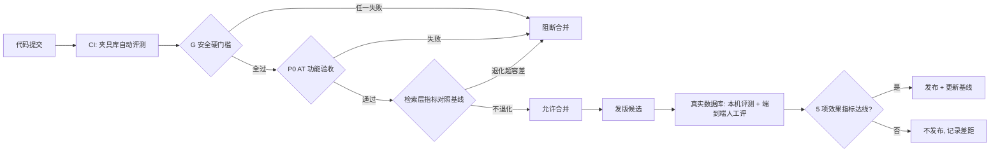

# Penpal V1 Eval PRD｜评测与发布判定 v1.1

> 文档版本：**v1.1 / 发布判定基线**（2026-10-10 产品负责人拍板）
> 更新日期：2026-10-10
> 变更记录：**v1.1（2026-10-10，D25）**：新增 §3.4A「bash 对照评测」；§3.2.2 纳入 AT21。
> 上游基线：`docs/Penpal_V2.md`（V1 PRD 开发基线 v1.2）。本文承接其 D16：基线 §5.3、§6.2、§6.4 中的「候选指标」由本文定义口径、数据集与通过线。
> 结构方法：参考《座舱 AI 智能体 PRD 模板》的「概述 → 定位 → 场景 → 模块（定义 / 逻辑 / 异常）→ 迭代 → ≤5 项可度量指标」，把**评测体系本身当成一个产品**来写。
> 标注：**【已确认】**（2026-10-10 产品负责人拍板，本文即发布判定基线）。

---

## 0. 结论先行

1. **V1 能否发布，由三层闸门依次判定**：① 安全硬门槛（只看是/否，不允许带病发布）→ ② P0 功能验收（基线 AT 用例全过）→ ③ 效果指标（5 项，达线才算「产品成立」）。前一层不过，后一层不用看。
2. **"越权泄露 = 0" 被写成可执行的测试定义**：用**金丝雀数据（canary）+ 差分对照**两种方法检测。判定口径是：同一个 Host，无论库里有没有它无权看的数据，拿到的响应必须完全一致。这条门槛只能收紧，不能放松。【已确认】
3. **效果分两层评，责任分开**。Penpal 核心不内置大模型，所以：
   - **检索层**（Penpal 完全可控）：自动跑，进 CI，每次提交都防退化；
   - **端到端层**（Host 的大模型参与）：固定参考 Host 和模型版本，发版前人工评一次。
   这样能避免把 Host 模型的波动算到 Penpal 头上，也避免 Penpal 拿"模型够聪明"掩盖检索做得差。
4. **评测集采用 Gold Set 机制**，与仓库现有 daily / weekly 的做法一致：先建基线，之后每次改动都和基线对比，确认不退化才允许合并。数据分两份：**合成夹具库**（可以进 git，跑 CI）和**负责人真实数据库**（只留在本机，标注也不出本机）。

---

## 一、评测基础信息

### 1.1 概述

| 项目 | 内容 |
|---|---|
| 名称 / 版本 | Penpal V1 Eval（评测与发布判定）v1.0 |
| 评测对象 | V1.0 P0 闭环：采集 → 入库 → 检索 / 证据 → MCP（Claude / Codex / Cursor）→ HUD / 控制 |
| 评测使用者 | **产品负责人**（做发布决策、标注真实数据）；**研发 / CI**（防退化）；**种子用户**（只做留存与主观反馈，不参与标注） |
| 核心场景 | ① 每次提交跑 CI 防退化；② 发版前跑完整判定；③ 改动检索、权限或 Schema 后对照基线复核 |
| 一句话定位 | **这是一套为 Penpal 发版设计的本地评测体系，用可复现的数据和明确的通过线回答两件事：它有没有泄露，它能不能真的帮用户把事实找回来。** |
| 非目标 | 不评 Host 大模型本身的能力；不评 P2 的 Skill / Method 质量（V2 再定）；**不回传任何用户内容做统计** |

### 1.2 评测流程图

### 1.3 评测模块清单

**优先级**：P0 = V1.0 发布前必须具备；P1 = V1.1 补齐；P2 = 远期。

| 模块 | 二级能力 | 优先级 | 描述（手段 → 解决什么 → 效果） | 依赖 |
|---|---|---|---|---|
| E1 安全门槛 | 越权泄露检测（金丝雀 + 差分） | P0 | 在无权数据中植入唯一标记串，并对比"有 / 无无权数据"两种情况下的响应 → 解决"说是隔离了，但其实漏了计数或提示" → 泄露可以被机器判定为 0 或非 0 | 权限引擎、MCP 接口 |
| E1 安全门槛 | 暂停 / 删除 / 鉴权阻断用例 | P0 | 自动执行基线 AT06 / AT10 / AT15 → 防止控制能力失效后仍然发布 | 基线 AT 用例 |
| E2 功能验收 | P0 AT 用例执行器 | P0 | 把基线 §6.3 的 P0 用例写成可重复运行的 E2E 脚本 → 避免"写库返回 200 就算通过" | 夹具库、测试 Host |
| E3 检索评测 | Recall Gold Set + 自动评分 | P0 | 用标注过的查询集计算证据召回与误命中 → 每次改检索都能看到效果是升是降 | 夹具库 / 真实库、评测 Runner |
| E4 端到端评测 | 参考 Host 人工评 | P0 | 固定 Host 和模型版本，由负责人判定"找对了，出处也对" → 回答"产品是否成立" | 参考 Host 配置、评分表 |
| E5 运行指标 | 新鲜度 / 时延 / 资源基线 | P0（新鲜度、时延）/ P1（资源） | 注入受控事件，测量到可检索的耗时；在固定数据规模下压测查询 | 性能夹具、参考机器 |
| E6 观测项 | 敏感过滤漏检、Memory 证据覆盖、留存 | P1（只观测，不阻断） | 登记缺陷、看趋势，不作为发布门槛 | 基线 AT07、访谈 |
| E7 基线治理 | Gold Set 版本化与防退化规则 | P0 | 基线入库，改基线要经负责人批准 → 防止"指标掉了就悄悄改分母" | git、评审流程 |

### 1.4 评测环境依赖

| 类别 | 依赖项 | 要求 | 状态 |
|---|---|---|---|
| 平台 | 参考机器 | 1 台固定的 Apple Silicon Mac，在评测报告中记录型号和 macOS 版本；时延和资源只在这台机器上判定 | 待工程指定 |
| 数据 | 夹具库 | 合成数据，可以进 git；覆盖 Claude / Codex / Git / Terminal / Files / Browser 六类 P0 源，以及四个分桶 | V0 阶段建设 |
| 数据 | 性能夹具 | 由生成器产出 10 万级事件（不进 git，只提交生成脚本和随机种子） | V0 阶段建设 |
| 数据 | 真实库 | 负责人本机 `~/.penpal` 的真实数据；**标注文件和评测明细都只存在本机**，只把汇总数字提交到 git | 【已确认】 |
| Host | 参考 Host | 端到端评测固定使用 1 个 Host 和固定模型版本（建议 Claude Code + 当时的主力模型），版本写进报告 | 【已确认】 |
| 隔离 | 测试运行 | 运行时把 HOME 重定向到临时目录，绝不读写真实用户库（真实库评测除外，且只读） | 已有做法 |

### 1.5 复用旧版评测资产（不从零开始）

旧仓库的采集侧已有一批**不依赖 LLM、只用合成数据的自动化测试**，可以直接作为 E2 / E3 / E6 的底座。日报、周报相关的评测器都和旧管道绑定，不复用。

| 旧资产 | 测什么 | 新 Eval 里的去向 | 处理方式 |
|---|---|---|---|
| `penpal/sources/cleaning/*` + `tests/test_cleaning_*.py` | 噪声过滤、去重、路径过滤、白名单 | E2 · AT08 增量去重 | 直接复用，随模块迁入核心 |
| `tests/test_sources_*.py`、`test_sources_discoverer_*.py` | Claude / Codex / Git / Chrome / Safari / zsh 等解析器的完整性 | E2 用例底座 + E3 夹具库的数据来源 | 复用；把其中的合成样本整理成统一的夹具库 |
| `penpal/privacy/detectors.py` + `tests/test_privacy_detectors.py` | 敏感串命中 | E6 · AT07 漏检观测 | 直接复用 |
| `penpal/capture/policy.py` + `test_capture_policy.py`、`test_blacklist.py` | 采集允许和排除策略 | E2 · AT18 排除名单 | 复用，补"入库零事件"的端到端断言 |
| `penpal/health/*` + `test_healthcheck*.py`、`test_hud_health.py` | 健康状态与新鲜度 | E2 · AT09 + E5 新鲜度 | 复用，先核查它和旧管道的耦合 |
| `penpal/quality/` 框架（registry / runner） | 规则化质量检查的运行框架 | E3 Runner 的骨架候选 | 可以借鉴；现有策略针对 Topic，不直接复用 |
| `daily_validator` / `weekly_validator`、`scripts/eval_*.py`、golden daily / weekly | 大模型写作质量 | — | **不复用**（绑定旧管道和 LLM） |

**真正需要新建的只有三块**：检索评测（E3：旧仓库没有检索质量评测）、越权泄露测试（G1：没有 MCP 代码，也就没有对应测试）、端到端评分表（E4）。

---

## 二、评测定位与目标

### 2.1 定位【已确认】

**问题**：基线 PRD 写了 19 个验收用例和一批候选指标，但至今没有"什么情况下可以发布"的判定规则。Penpal 核心又不内置模型，"找回效果"天然混着 Host 模型的能力。
**目标**：把发布决策变成一个**可复现、可防退化、责任清晰**的判定流程。
**价值**：负责人能按报告直接拍板发不发；研发改检索、权限、Schema 时，CI 会立即暴露退化；对外说"不泄露"时，背后有可执行的证明。

### 2.2 评测使用者与场景

| 角色 | 场景 | 诉求 |
|---|---|---|
| 产品负责人 | 发版前决策 | 一页报告：三层闸门各自是否通过、差距在哪里、和上一版相比的变化 |
| 产品负责人 | 标注真实数据 | 每版标注成本可控（建议 ≤ 2 小时），标注界面不需要写代码 |
| 研发 | 修改检索或权限代码 | 本地一条命令跑完夹具评测，5 分钟内出结果 |
| CI | 每次 PR | 安全门槛和 P0 用例自动执行；检索指标退化超过容差就阻断 |
| 种子用户 | 日常使用 | 不打扰；只在同意后参与 7 / 14 / 30 天回访 |

---

## 三、评测模块设计

### 3.1 E1 安全硬门槛（P0，阻断）

#### 3.1.1 定义

任何一项失败，**直接阻断发布**。不设通过率，只看是否为 0。【已确认：越权泄露 = 0 是硬门槛，Eval PRD 不得放松（基线冲突决议 3）】

#### 3.1.2 门槛清单

| ID | 门槛 | 判定口径 | 对应基线 |
|---|---|---|---|
| G1 | **越权泄露 = 0** | 见 3.1.3：金丝雀命中数 = 0，且差分对照不一致数 = 0 | AT05、B1、§8.2 |
| G2 | 鉴权绕过 = 0 | 无 token、错误 token、不在白名单的 client、已撤销或已轮换的 token：全部被拒，不返回任何数据或计数，并写入审计 | AT15 |
| G3 | 暂停失效 = 0 | 暂停后（包括重启后）新增内容事件数 = 0 | AT06 |
| G4 | 删除残留 = 0 | 删除后，按同样条件查原文、FTS、派生 Memory、缓存，命中数都为 0 | AT10 |
| G5 | 自身凭据外露 = 0 | Penpal 自己的 token / Grant 凭据明文，在库、日志、审计、诊断包中的出现次数 = 0 | B6、冲突决议 2 |

#### 3.1.3 G1 越权泄露的测法【已确认】

"泄露"的定义：对一个 Host 来说，**任何**能让它推断出"无权范围内存在某些内容"的信息都算泄露，包括原文、摘要、片段、命中数、"存在 / 不存在"的暗示、无权来源或分桶的名称，出现在任意响应字段、错误信息、`coverage.note` 或分页信息里。

| 方法 | 做法 | 通过条件 |
|---|---|---|
| **金丝雀扫描** | 在 Private / Financial 桶以及该 Host 未授权的来源中，植入 ≥ 50 条唯一标记串（如 `KPCANARY-7f3a…`）；再用对抗查询集（直接搜标记串、搜同义词、宽时间范围、通配、超长分页）调用全部 MCP 工具 | 所有响应、错误信息、审计中可被 Host 读到的部分里，标记串出现 0 次 |
| **差分对照** | 准备两个库：A = 只有已授权数据；B = A + 无权数据。同一 Host 执行同一批查询 | 去掉 id、时间戳、耗时这类字段后，A 和 B 的响应**逐字节一致**（包括结果数、`partial`、`note`、错误码） |
| **写路径越权** | 用 `commit_memory` 引用无权 Evidence、写入未授权的桶 | 全部被拒，且拒绝信息不透露目标是否存在（与 AT16 联动） |

- 差分对照是这道门槛的核心：它不需要穷举所有泄露方式，**只要响应随无权数据变化，就判定为泄露**。
- 不在范围内：通过响应时延推断（侧信道）。V1 不评，在风险表登记。

#### 3.1.4 异常处理

- 门槛用例本身不稳定（时有时无）时，按失败处理，查清原因前不允许重跑刷通过。
- 新增 MCP 工具或响应字段时，必须同时加入金丝雀和差分覆盖，否则 CI 视为未覆盖、阻断合并。

---

### 3.2 E2 P0 功能验收（P0，阻断）

#### 3.2.1 定义

基线 §6.3 里优先级为 P0 的 AT 用例，必须**全部通过**才能进入效果评测。

#### 3.2.2 用例范围

| 类型 | 用例 | 判定 |
|---|---|---|
| 阻断（已并入 E1） | AT05、AT06、AT10、AT15 | 见 G1–G4 |
| P0 功能 | AT01、02、03、04、08、09、12、13、16、17、18、19、21 | 全部通过；每条至少覆盖"有答案 / 无答案 / 权限受限"三种变体（基线 §6.3 原则） |
| 非阻断 | AT07（敏感过滤）、AT11（新旧版本，P1）、AT14（P2） | 只记录结果，不阻断（见 E6） |

#### 3.2.3 异常处理

- 某个 Host 版本升级导致 AT17 失败：记录 Host 版本号，判定为"该 Host 暂不可用"。三个 Host 中任何一个不通过，都不能宣布 P0 完成（基线 §6.4 第 4 条）。

---

### 3.3 E3 检索层评测：Recall Gold Set（P0）

#### 3.3.1 定义

衡量 Penpal **自己负责的部分**：给定查询，能不能把正确的证据排进前几位；没有答案时，会不会返回误导性结果。不经过 Host 模型，结果完全确定，可以进 CI。

#### 3.3.2 评测集结构【已确认】

| 变体 | 夹具库条数 | 真实库条数 | 标注内容 |
|---|---|---|---|
| 有答案 | 50 | 30 | 查询、能支持答案的 evidence_id 集合、所属场景（W01 / W02 / L01 / L02 / 跨源） |
| 无答案 | 15 | 10 | 查询；标注"任何结果都不应被当成答案" |
| 权限受限 | 10 | — | 查询、Host 授权范围（与 G1 共用无权数据） |
| 冲突 / 过期 | 5 | 5 | 只记录（AT11 为 P1） |
| **合计** | **80** | **45** | 四个场景每个至少 8 条，跨源至少 8 条 |

- 查询写法要贴近真实提问：模糊线索、人名别名、相对时间（"上周""昨天"）、同名项目都要覆盖（基线 §8.3）。
- 夹具库的标注进 git；真实库的标注只存在本机 `~/.penpal/eval/`（【已确认】）。

#### 3.3.3 评分逻辑

1. Runner 对每条查询调用 `search_context`（与 Host 走同一套接口和权限），取前 5 条结果。
2. **证据召回 @5**：前 5 条里至少有 1 条命中标注的 evidence_id，就记为命中。
3. **无答案误命中**：在无答案查询中，返回了结果、而且结果没有被标记为低确定性（基线 §3.7.3 的低确定性策略）的条数，除以无答案查询总数。
4. 输出 JSON 报告：每条查询的结果，以及按场景、按来源的分组汇总。

#### 3.3.4 防退化规则【已确认】

- CI 每次 PR 都在夹具库上运行；任何一项指标比基线下降**超过 2 个百分点**就阻断。
- 指标提升后，基线跟着更新（需要在 PR 里说明原因）。**下调基线或改动评测集必须由负责人批准**，与 daily / weekly 的 Gold Set 规则一致。

---

### 3.4 E4 端到端评测（P0，发版前）

#### 3.4.1 定义

在参考 Host 里用自然语言提问，评判"用户能不能拿到正确事实，并带着可核验的出处"。这一层回答基线 §9.3 的"V1 产品是否成立"。

#### 3.4.2 流程

1. 从真实库评测集中取有答案 30 条、无答案 10 条，在参考 Host 中逐条提问（新会话，不带其他上下文）。
2. 负责人对每条按下表打分（评分表是一个本地 Markdown 或 CSV，填写即可，不需要写代码）：

| 结论 | 条件 |
|---|---|
| ✅ 找回 | 事实正确，并且至少给出 1 个能打开、能核对的出处 |
| ⚠️ 部分 | 事实正确但没有出处，或者出处打不开 |
| ❌ 失败 | 事实错误、编造，或者有答案却说找不到 |
| ✅ 正确拒答（仅无答案题） | 明确说未找到，没有用近似内容凑一个答案 |

3. 报告里记录 Host 名称、版本和模型 ID。换模型后再评，结果不和旧基线直接比较。

#### 3.4.3 异常处理

- 某题失败的原因是 Host 没有调用 Penpal：单独计为"未调用"，不算进 Penpal 的失败，但要统计未调用比例。如果超过 20%，说明 Host 适配或工具描述有问题，按功能缺陷处理。
- 真实库里某个场景的数据不够（比如近期没有 L02 类的事件）：可以用夹具补足，但报告里要标明。

---

### 3.4A bash 对照评测（D25，发版前）

#### 3.4A.1 定义

回答 D25 的核心问题：「AI 自己能用 bash 读本机文件，Penpal 为何必须存在？」同一批端到端问题分别交给两组 Host 作答，检验 Penpal 是否带来可度量的增益。

#### 3.4A.2 分组与比较项

| 组 | 配置 |
|---|---|
| A 组 | 参考 Host，仅有 bash / 文件读取能力，不接 Penpal MCP |
| B 组 | 同一参考 Host + Penpal MCP |

| 比较项 | 口径 |
|---|---|
| 找回率 | 沿用 3.4.2 评分表（✅ 找回 / ⚠️ 部分 / ❌ 失败） |
| 完成耗时 | 新会话提问到给出最终答案的挂钟时间（取中位数） |
| token 消耗 | Host 报告的输入 + 输出 token 总数 |
| 越权接触次数 | A 组：接触到的文件是否含 Private / Financial 夹具，命中即计 1 次；B 组：按 G1 口径（金丝雀命中数 + 差分不一致数）计 |

#### 3.4A.3 流程与数据

1. 题目取自 3.4.2 的同一批有答案 / 无答案题。
2. 两组各自在新会话中逐题作答；报告记录 Host 名称、版本和模型 ID（同 3.4.2）。
3. 只用合成夹具 + 真实 Host。涉及真实数据的部分只在负责人本机运行，明细不出本机（同 7.2 真实数据规则）。

#### 3.4A.4 发布判定

- **通过**：B 组找回率不低于 A 组，且耗时、token、越权接触三项中至少两项显著更优。
- **不通过**：相关功能须书面说明存在理由（对应 D25 四点之一）。
- 「显著更优」的量化阈值待首轮实测后由负责人确认，确认后只升不降（同第五章通过线规则）。
- 本项为发版前判定，不计入第五章的 5 项指标。

---

### 3.5 E5 运行指标（P0 新鲜度、时延；P1 资源）

| 项目 | 测法 | 判定 |
|---|---|---|
| 结构化源新鲜度 | 向夹具源追加一条已知记录，计时到 `search_context` 能查到为止，重复 20 次 | P95 |
| 动态活动新鲜度 | 注入受控活动事件，同样计时，重复 20 次 | P95 |
| 查询时延 | 在性能夹具（10 万级事件）上运行固定的 100 条查询，不含 Host 推理 | P95 |
| 资源基线（P1） | 在参考机器上分空闲 / 轻采集 / 首次导入 / 索引重建四种工况，各测 CPU、内存、磁盘增长 | V1.0 只出报告，不设线；V1.1 依据数据定线（基线 §5.3） |

---

### 3.6 E6 观测项（P1，不阻断）

| 项目 | 口径 | 去向 |
|---|---|---|
| 敏感过滤漏检 | AT07 夹具中漏过滤的条数 / 总条数 | 登记为 P1 加固缺陷（基线 D13） |
| Memory 证据覆盖 | 有有效 Evidence 的长期 Memory 数 / 抽查数。`commit_memory` 在结构上强制要求带 Evidence，这里是防回归抽查 | 低于 100% 就作为缺陷处理 |
| 留存 | 种子用户 7 / 14 / 30 天仍在使用的比例和关闭原因，通过人工回访收集，**不做遥测** | V1.1 的需求输入 |

---

## 四、报告与发布判定

### 4.1 发布判定规则【已确认】

| 层级 | 内容 | 不通过时 |
|---|---|---|
| ① 安全硬门槛 | G1–G5 全部为 0 | **不发布**，没有例外 |
| ② P0 功能 | E2 用例全部通过（三个 Host 都通过） | 不发布 |
| ③ 效果指标 | 第五章的 5 项全部达线 | 不发布；负责人可以书面豁免**一项**并写明原因和补救版本，**G1–G5 不可豁免** |

### 4.2 报告格式

每次发版生成一份报告 `docs/eval-reports/V1.x-YYYYMMDD.md`，只包含汇总数字，不含真实内容：三层判定结论 → 5 项指标的本次值、通过线、上次值 → 失败或豁免明细 → 环境信息（机器、Host、模型、评测集版本）。

---

## 五、指标与通过线（V1.0）

> 只设 5 项，要求可度量、可回收、可监控。通过线按**已确认**规则执行（【已确认】）：先用本表初值；首次实测基线后由负责人确认一次；之后**只能上调**，不得下调。

| # | 指标 | 层级 | 口径 | V1.0 通过线 |
|---|---|---|---|---|
| M1 | 证据召回 @5 | 检索层 | 有答案查询中，前 5 条命中标注证据的比例 | 夹具库 ≥ 85%；真实库 ≥ 70% |
| M2 | 无答案误命中率 | 检索层 | 见 3.3.3 第 3 条 | 夹具库 ≤ 10% |
| M3 | **端到端有效找回率** | 端到端 | 有答案题中"✅ 找回"的比例（"未调用"不计入分母，单独报告） | ≥ 70% |
| M4 | 新鲜度 P95 | 运行 | 结构化源 / 动态活动 | ≤ 5 分钟 / ≤ 30 秒 |
| M5 | 查询时延 P95 | 运行 | 10 万级事件，参考机器 | ≤ 2 秒 |

补充：无答案题的"正确拒答率"（端到端）作为 M3 的配套项一起报告，**目标 ≥ 90%**，不单独设为门槛。它很大程度取决于 Host 模型，Penpal 这一侧由 M2 负责。

---

## 六、迭代计划

| 阶段 | 评测范围 | 出口条件 |
|---|---|---|
| **V0 · 评测基建**（与核心骨架并行） | 把 1.5 节中可复用的旧测试迁入核心并整理成统一夹具库；新建性能夹具生成器、检索 Runner、G1 金丝雀和差分框架；接入 CI | 在 legacy 代码或新核心上能跑通一次，产出第一份基线报告 |
| **V1.0** | E1–E5 全部启用；真实库标注 45 条；第一次端到端评测 | 满足 4.1 的三层判定 |
| **V1.1** | 冲突 / 过期题升为指标（AT11）；跨 Host 续接评测（W04）；资源定线；留存回访 | 新指标完成基线并防退化 |
| **V2.0** | Method / Skill 人工评价（AT14） | 另行定义 |

---

## 七、风险与决策记录

### 7.1 风险

| 风险 | 影响 | 缓解 |
|---|---|---|
| 评测集太小，或和真实提问差距大 | 指标好看但用户没用 | 真实库题目由负责人从真实回忆需求中出；每版新增 ≥ 10 条新题 |
| 指标被刷（只针对评测集调参） | 过拟合 | 每版留出 20% 不公开的真实库题，只在发版时使用 |
| Host 模型变化导致端到端波动 | 误判退化 | 记录模型版本；检索层负责防退化，端到端只用于发版判定 |
| 侧信道泄露（时延推断） | G1 未覆盖 | V1 登记为已知风险，不评测 |
| 标注成本让负责人拖延发版 | 节奏变慢 | 每版标注控制在 2 小时内；夹具库承担大部分自动评测 |

### 7.2 已拍板决策（2026-10-10）

| 决策 | 结论 |
|---|---|
| 发布闸门 | 安全门槛 G1–G5 不可豁免；5 项效果指标可书面豁免 1 项并写明补救版本 |
| 端到端门槛 | M3 端到端有效找回率 ≥70% 为 V1.0 发布门槛 |
| 通过线 | 先用第五章初值；首次实测后确认一次，之后只升不降 |
| 真实数据 | 只用负责人本机数据，标注与明细只存 `~/.penpal/eval/`，仓库只提交汇总数字；用真实数据生成的任何评测产物不得提交（见 brain `no-real-data-in-repo`） |
| 泄露测法 | 金丝雀扫描 + 差分对照 |
| 评测集规模 | 合成 80 题 + 真实 45 题（结构见 3.3.2），真实集留 20% 不公开题，每版新增 ≥10 题 |

---

**文档状态：v1.1 / 发布判定基线。** 基线 PRD §5.3 / §6.2 / §6.4 中关于成功判定的引用均指向本文。
